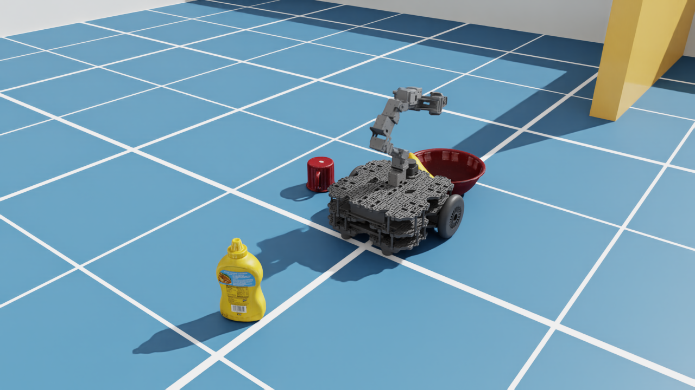
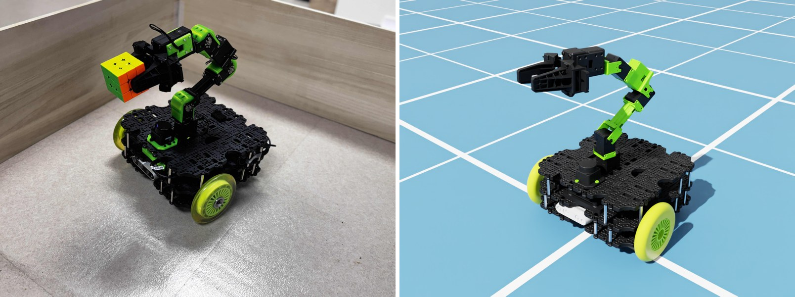

# TurtleBot3 Lime × Isaac Sim 6.2 — beginner tutorials

**📖 Tutorials: https://sakaki-an.github.io/Turtlebot3_Lime_IsaacSim/**

Learn NVIDIA **Isaac Sim 6.2** step by step with one robot: the **TurtleBot3 Lime**, a mobile
manipulator with a differential-drive base, a 6-DoF arm with gripper, a RealSense D435 and a 2D LiDAR.
The tutorials follow the structure of NVIDIA's Isaac Sim tutorials. Each one has a **GUI** walkthrough,
a **standalone Python script**, and a video of the result. **ROS 2 Jazzy** (Nav2, MoveIt 2, YOLO) runs in
a Docker container next to Isaac Sim.





*Left: the real TurtleBot3 Lime (photo: [Momoi Open Source](https://github.com/momoiorg-repository)). Right: the
simulated Lime in Isaac Sim, painted with the real robot's colours (tutorial 03).*

## Quick start

```bash
git clone https://github.com/sakaki-an/Turtlebot3_Lime_IsaacSim.git
cd Turtlebot3_Lime_IsaacSim

./scripts/setup_isaacsim.sh          # Isaac Sim 6.2 (pip) into .venv/  (~24 GB)
./docker/run_ros.sh true             # build + start the ROS 2 Jazzy container (first time ~15 min)

# terminal 1
source scripts/isaac_env.sh          # every terminal that runs Isaac Sim
python isaac/00_check_setup.py --headless       # publishes /clock for 60 s

# terminal 2
./docker/run_ros.sh ros2 topic echo /clock --once
```

Then follow the [tutorials](https://sakaki-an.github.io/Turtlebot3_Lime_IsaacSim/).

## Tutorials

| # | Tutorial | Script |
|---|---|---|
| 00 | Setup | `isaac/00_check_setup.py` |
| 01 | Isaac Sim basics & Hello World | `isaac/01_hello_world.py` |
| 02 | Import TurtleBot3 Lime (URDF → USD) | `isaac/02_import_urdf.py` |
| 03 | Tune the robot (drives, friction, solver), before and after | `isaac/03_tune_robot.py`, `isaac/03_before_after.py` |
| 04 | Move it from Python (Articulation API) | `isaac/04_hello_robot.py` |
| 05 | Your first Action Graph (keyboard driving) | `isaac/05_action_graph.py` |
| 06 | Drive with ROS 2 `/cmd_vel` (Action Graph) | `isaac/06_ros2_drive.py` |
| 07 | Odometry, TF, joint states, RViz | `isaac/07_odom_tf.py` + `ros2 launch lime_isaac_bringup view_robot.launch.py` |
| 08 | Camera: RealSense D435 RGB, depth, camera_info | `isaac/08_camera.py` |
| 09 | LiDAR (LDS-01 as RTX LiDAR) and IMU | `isaac/09_lidar_imu.py` + `ros2 launch lime_isaac_bringup view_sensors.launch.py` |
| 10 | Object detection with YOLO (ROS 2 node, Ultralytics) | `isaac/10_yolo.py` + `ros2 launch lime_yolo yolo.launch.py` |
| 11 | Navigation with Nav2 (map from the scene, AMCL, goals) | `isaac/11_make_map.py`, `isaac/11_nav2.py` + `ros2 launch lime_isaac_bringup navigation.launch.py` |
| 12 | Arm control with MoveIt 2 (ros2_control over topics) | `isaac/12_moveit.py` + `ros2 launch lime_isaac_moveit moveit.launch.py` |
| 13 | Pick and place (YOLO + depth, MoveIt 2, Nav2) | `isaac/13_all_together.py` + `ros2 launch lime_isaac_bringup lime_full.launch.py` |
| 14 | Make your own map with SLAM (slam_toolbox) | `isaac/14_slam.py` + `ros2 launch lime_isaac_bringup slam.launch.py` |
| 15 | Behavior trees (Nav2's tree, a py_trees patrol) | `isaac/15_behavior_tree.py` + `ros2 launch lime_isaac_bringup navigation.launch.py` + `ros2 run lime_isaac_bringup patrol` |
| 16 | All together: tidy the room (search, check, pick and place three bananas) | `isaac/16_tidy_room.py` + `ros2 launch lime_isaac_bringup tidy.launch.py` + `ros2 run lime_isaac_bringup tidy` |

Every script accepts `--headless`, `--test` (automatic check, prints `PASS`/`FAIL`) and `--record NAME`
(saves the media used on the website). `tools/run_all_checks.sh` runs every check.

## Repository layout

```text
isaac/                 standalone Isaac Sim scripts, one per tutorial (+ common/ helpers)
assets/urdf/           TurtleBot3 Lime URDF for Isaac Sim (generated from the xacro)
assets/usd/            imported robot USD + tuned robot (turtlebot3_lime_tuned.usda)
ros2_ws/src/           ROS 2 Jazzy workspace (vendored TurtleBot3 Lime packages, ported from Humble)
docker/                ROS 2 Jazzy container (Nav2, MoveIt 2, ros2_control, YOLO, py_trees)
scripts/               setup and environment scripts
docs/                  the tutorial website (MkDocs Material, deployed to GitHub Pages)
```

## Requirements

Ubuntu 22.04/24.04, an NVIDIA RTX GPU (tested: RTX 5080, driver 580), about 40 GB of disk, and Docker.

**Why Jazzy and not Humble?** Isaac Sim 6.2 supports ROS 2 Humble only on Ubuntu 22.04, and Jazzy on
Ubuntu 24.04. The TurtleBot3 Lime packages (`humble-devel`) are ported to Jazzy here.

## Credits & license

Apache-2.0. The TurtleBot3 Lime description and MoveIt configuration come from
[ROBOTIS-JAPAN-GIT/turtlebot3_lime](https://github.com/ROBOTIS-JAPAN-GIT/turtlebot3_lime) (Apache-2.0).
This project is the Isaac Sim 6.2 successor of
[Turtlebot3_Lime_IsaacSim_Humble](https://github.com/momoiorg-repository/Turtlebot3_Lime_IsaacSim_Humble).
See [NOTICE](NOTICE).
