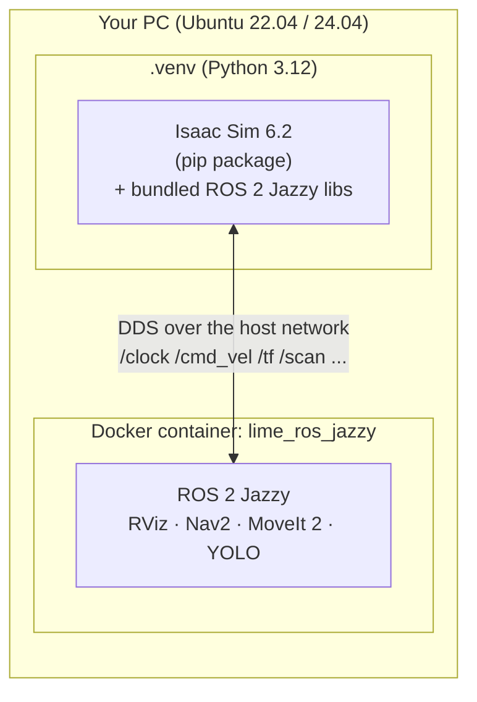

# 00 · Setup

<p class="tutorial-meta">⏱ 30–60 min (mostly downloads) · Level: beginner</p>

**Goal.** Install Isaac Sim 6.2, start the ROS 2 Jazzy container, and check that the two can talk to each other.

## What you will install



- **Isaac Sim** runs directly on your PC, from a Python virtual environment inside this repository.
  It brings its **own copy of the ROS 2 Jazzy libraries**, so its ROS 2 bridge works without a ROS install.
- **ROS 2 Jazzy** runs in a **Docker container**: RViz, Nav2, MoveIt 2, ros2_control, the YOLO node and
  the TurtleBot3 Lime packages. It shares your PC's network, so ROS 2 nodes on both sides find each other.

## Requirements

| | |
|---|---|
| OS | Ubuntu 24.04 (tested) or 22.04 |
| GPU | NVIDIA RTX, 16 GB VRAM recommended (tested: RTX 5080) |
| Driver | a recent NVIDIA driver (tested: 580.178) |
| Disk | ~40 GB (Isaac Sim ≈ 24 GB, ROS container ≈ 6 GB) |
| Software | `git`, `curl`, [Docker](https://docs.docker.com/engine/install/ubuntu/) (run without `sudo`) |

## 1. Get the repository

```bash
git clone https://github.com/sakaki-an/Turtlebot3_Lime_IsaacSim.git
cd Turtlebot3_Lime_IsaacSim
```

## 2. Install Isaac Sim 6.2

```bash
./scripts/setup_isaacsim.sh
```

The script:

1. creates a Python 3.12 virtual environment in `.venv/` (using [uv](https://docs.astral.sh/uv/));
2. runs `pip install "isaacsim[all,extscache]==6.2.0.0" --extra-index-url https://pypi.nvidia.com`
   (several GB);
3. installs `imageio-ffmpeg`, which the tutorials use to save videos;
4. adds a small fix for the GUI app (see [Troubleshooting](../reference/troubleshooting.md#core-extensions-fail-to-load-charset_normalizer)).

??? note "Prefer the official zip / workstation install? (not tested here)"
    It should work, but these tutorials were verified only with the pip install. Wherever these tutorials say `python isaac/xx.py`, use `~/isaacsim/python.sh isaac/xx.py`.
    `isaac-sim.sh` sets up the bundled ROS 2 libraries by itself, so you can skip `scripts/isaac_env.sh`.
    You still need the `DDS` variables from that file (`ROS_DOMAIN_ID`, `RMW_IMPLEMENTATION`, Fast DDS profile).

## 3. Prepare a terminal for Isaac Sim

Do this in **every new terminal** in which you start Isaac Sim:

```bash
source scripts/isaac_env.sh
```

It activates `.venv` and sets four things:

| Variable | Why |
|---|---|
| `ROS_DISTRO=jazzy`, `LD_LIBRARY_PATH=…/isaacsim.ros2.core/jazzy/lib` | Isaac Sim loads its **bundled** ROS 2 Jazzy libraries. A pip install has no `isaac-sim.sh` launcher to do this, and it must happen *before* Isaac Sim starts. |
| `RMW_IMPLEMENTATION=rmw_fastrtps_cpp`, `FASTDDS_DEFAULT_PROFILES_FILE` | The same DDS settings as the container (UDP only), so topics flow between them. |
| `ROS_DOMAIN_ID` (default `0`) | Must match the container. |

It also **removes** any ROS environment you sourced before (for example `/opt/ros/jazzy`), so Isaac Sim never mixes a system ROS with its own libraries.

Start the Isaac Sim GUI with:

```bash
isaacsim
```

The first start takes a few minutes while shaders compile. Later starts take seconds.

## 4. Start the ROS 2 Jazzy container

```bash
./docker/run_ros.sh
```

The first call builds the image `lime_ros_jazzy` from `docker/ros_jazzy/Dockerfile` (10–20 min), then opens a shell
inside the container with ROS 2 sourced. Later calls reuse the running container named `lime_ros`.

```bash
./docker/run_ros.sh                      # interactive shell
./docker/run_ros.sh ros2 topic list      # run one command
```

!!! tip "Slow `apt` downloads while building?"
    Choose a closer Ubuntu mirror. It replaces both `archive.ubuntu.com` and `security.ubuntu.com`:
    ```bash
    UBUNTU_MIRROR=http://ftp.udx.icscoe.jp/Linux/ubuntu/ ./docker/run_ros.sh
    ```

??? note "Want ROS 2 natively instead of Docker? (not tested here)"
    These tutorials were verified only with the container. On Ubuntu 24.04 you can install the same packages the Dockerfile installs:
    `sudo apt install ros-jazzy-desktop ros-jazzy-navigation2 ros-jazzy-nav2-bringup ros-jazzy-slam-toolbox ros-jazzy-moveit ros-jazzy-ros2-control ros-jazzy-ros2-controllers ros-jazzy-gripper-controllers ros-jazzy-joint-state-topic-hardware-interface ros-jazzy-xacro ros-jazzy-realsense2-description ros-jazzy-vision-msgs ros-jazzy-cv-bridge ros-jazzy-teleop-twist-keyboard ros-jazzy-py-trees ros-jazzy-py-trees-ros`.
    Then use the same `ROS_DOMAIN_ID`, `RMW_IMPLEMENTATION` and Fast DDS profile as `scripts/isaac_env.sh`.
    Never source `/opt/ros/jazzy` in the terminal that runs Isaac Sim.

## 5. Check that everything talks

Terminal 1, Isaac Sim (headless, no window needed):

```bash
source scripts/isaac_env.sh
python isaac/00_check_setup.py --headless
```

Terminal 2, ROS 2 container:

```bash
./docker/run_ros.sh ros2 topic echo /clock --once
```

You should see:

```text
clock:
  sec: 6
  nanosec: 716666666
---
```

That message was produced by an Action Graph in Isaac Sim and received by ROS 2 in the container. 🎉

??? example "The script: `isaac/00_check_setup.py`"
    ```python
    --8<-- "isaac/00_check_setup.py"
    ```

!!! success "Automatic check"
    `python isaac/00_check_setup.py --headless --test` subscribes to `/clock` from inside Isaac Sim
    and prints `[00][test] ... PASS`.

## Troubleshooting

| Symptom | Fix |
|---|---|
| `ROS2 Bridge startup failed … libament_index_cpp.so` | You did not `source scripts/isaac_env.sh` in this terminal, or you sourced `/opt/ros/...` after it. |
| `ros2 topic list` shows `/clock` but `echo` prints nothing | DDS mismatch: same `ROS_DOMAIN_ID` on both sides? Firewall blocking UDP? |
| Isaac Sim window is black for a long time | The first start compiles shaders (several minutes). Wait. |

More in [Troubleshooting](../reference/troubleshooting.md).

**Next:** [01 · Isaac Sim basics & Hello World](01-hello-world.md)
