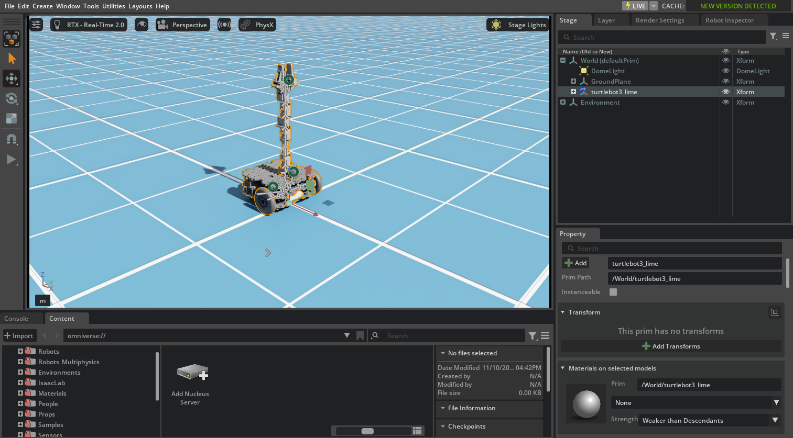

# 01 · Isaac Sim basics & Hello World

<p class="tutorial-meta">⏱ 20 min · Level: first contact · Script: <code>isaac/01_hello_world.py</code></p>

**Goal.** Find your way around the Isaac Sim window, and write your first standalone Python script: a falling
cube next to the TurtleBot3 Lime.

<figure class="result" markdown>
<video controls autoplay loop muted playsinline>
  <source src="../../assets/video/tutorial01_hello_world.mp4" type="video/mp4">
</video>
</figure>

## The window

{ .full }

| Area | What it is for |
|---|---|
| **Viewport** (centre) | The 3D view. Right mouse button + `WASD` to fly, `F` to frame the selection, scroll to zoom. The toolbar above it chooses the renderer and the camera. |
| **Stage** (top right) | The scene as a tree of *prims* (USD objects): `/World/GroundPlane`, `/World/turtlebot3_lime`, … |
| **Property** (bottom right) | Everything about the selected prim: transform, physics, materials, variants. |
| **Content / Console** (bottom) | NVIDIA's asset library and your files, and the log. |
| **Play ▶ / Stop ■** (left toolbar) | Start and stop the simulation. Physics, sensors and ROS 2 only run while playing. |

!!! info "USD in one paragraph"
    Isaac Sim scenes are **USD** stages: a tree of prims with attributes. A prim gets behaviour by applying
    *schemas*. `UsdPhysics.RigidBodyAPI` makes it move with gravity, `CollisionAPI` makes it touch other objects,
    `ArticulationRootAPI` turns a tree of links and joints into a robot. A stage can *reference* other USD files.
    The Lime is one file (`assets/usd/turtlebot3_lime_tuned.usda`) referenced into each scene.

## Try it in the GUI

1. `source scripts/isaac_env.sh && isaacsim`
2. **Create ▸ Physics ▸ Ground Plane**.
3. **Create ▸ Shape ▸ Cube**. In **Property ▸ Transform** set *Translate* z = 1.
4. With the cube selected: **Add ▸ Physics ▸ Rigid Body with Colliders Preset**.
5. Drag `assets/usd/turtlebot3_lime_tuned.usda` from the **Content** browser into the viewport. This adds the robot as a reference.
6. Press **Play** ▶. The cube falls and the robot stands on its wheels.

## The same in Python

A *standalone* script starts Isaac Sim itself, so it can run without a window, for example on a server or in tests:

```bash
source scripts/isaac_env.sh
python isaac/01_hello_world.py
python isaac/01_hello_world.py --headless --test
```

Every script in this project has the same four steps:

```python
from isaacsim import SimulationApp
simulation_app = SimulationApp({"headless": False})       # 1. start Isaac Sim - always first!

import isaacsim.core.experimental.utils.stage as stage_utils   # (imports only after SimulationApp)
stage = stage_utils.create_new_stage(template="sunlight") # 2. build a scene
GroundPlane("/World/GroundPlane")
cube = Cube("/World/LimeCube", sizes=0.2, positions=[0.6, 0.0, 1.0], colors=["limegreen"])
UsdPhysics.RigidBodyAPI.Apply(stage.GetPrimAtPath("/World/LimeCube"))
UsdPhysics.CollisionAPI.Apply(stage.GetPrimAtPath("/World/LimeCube"))

SimulationManager.setup_simulation(dt=1.0 / 60.0)       # 3. physics settings, then Play
app_utils.play()

while simulation_app.is_running():                      # 4. step: render + physics
    simulation_app.update()
```

```text
[01] t = 0.5 s   cube height = 0.791 m
[01] t = 1.0 s   cube height = 0.100 m
[01][check] ok   cube landed on the floor (centre at 0.100 m = half its size)
[01][check] ok   robot stands on its wheels (base_link at 0.060 m = wheel radius)
[01][check] ok   robot has 10 joints that can move
[01][test] PASS
```

!!! tip "Which Python API?"
    Isaac Sim 6.x recommends the `isaacsim.core.experimental.*` modules (`prims`, `objects`, `utils`) together with
    `SimulationManager`. Older tutorials on the internet use `World` from `isaacsim.core.api`. It still works in 6.2,
    but it is **deprecated**, so these tutorials use the new API.

??? example "Full script: `isaac/01_hello_world.py`"
    ```python
    --8<-- "isaac/01_hello_world.py"
    ```

**Next:** [02 · Import TurtleBot3 Lime](02-import-urdf.md), where the robot file comes from.
