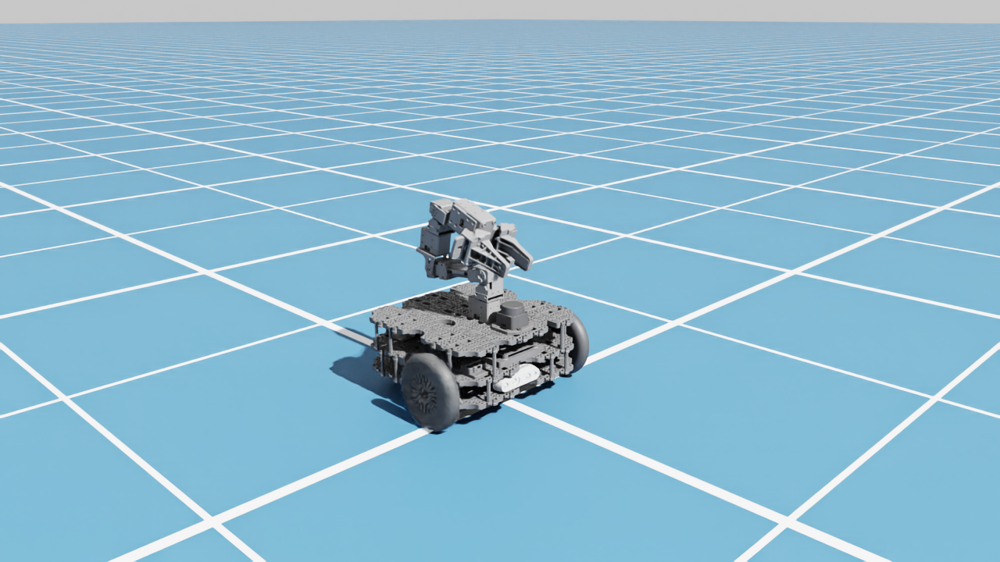

# 02 · Import TurtleBot3 Lime (URDF → USD)

<p class="tutorial-meta">⏱ 15 min · Level: beginner · Script: <code>isaac/02_import_urdf.py</code></p>

**Goal.** Turn the robot description that ROS uses (URDF) into the format Isaac Sim simulates (USD),
and understand what the importer creates.

<figure class="result" markdown>
<video controls autoplay loop muted playsinline>
  <source src="../../assets/video/tutorial02_import.mp4" type="video/mp4">
</video>
<figcaption>Right after import the arm collapses: the joint drives have no stiffness yet. Tutorial 03 fixes that.</figcaption>
</figure>

## Concepts

**URDF** is ROS's XML robot description: *links* (rigid parts with meshes, mass, inertia, collision
shapes) connected by *joints* (fixed, revolute, continuous, prismatic). The Lime's URDF lives in
`ros2_ws/src/turtlebot3_lime/turtlebot3_lime_description/urdf/*.xacro`.

**USD** (Universal Scene Description) is the scene format of Omniverse and Isaac Sim. A robot in USD is a
tree of *prims*. Physics is added with *schemas* such as `RigidBodyAPI`, `ArticulationRootAPI` and `DriveAPI`.

The **URDF importer** (`isaacsim.asset.importer.urdf`) converts one into the other.

!!! info "We import a generated `.urdf`, not the `.xacro`"
    The importer does not read xacro. `scripts/gen_urdf.sh` expanded the xacro once and rewrote the
    mesh paths so they work without ROS. The result is committed as `assets/urdf/turtlebot3_lime.urdf`.
    You only need to run that script if you change the xacro files.

### What the 6.2 importer creates

```text
assets/usd/turtlebot3_lime/
├── turtlebot3_lime.usda          ← the file you open or reference ("interface" layer)
└── payloads/
    ├── base.usda                 ← the prim tree: Geometry/ (links) and Physics/ (joints)
    ├── geometries.usd            ← the meshes
    ├── materials.usda, instances.usda
    ├── robot.usda                ← Isaac robot schema (robot type, ordered links and joints)
    └── Physics/
        ├── physics.usda          ← engine-neutral USD Physics (bodies, joints, drives, masses)
        ├── physx.usda            ← PhysX-specific additions
        └── mujoco.usda           ← MuJoCo/Newton-specific additions
```

The interface file has a **variant set called `Physics`** with the choices `none`, `physics`, `physx`
and `mujoco`. **No variant is selected by default.** Without a selection the robot has *no physics*:
it would float, and no articulation would be found. Isaac Sim simulates with PhysX by default, so
**select `physx`**.

Inside the robot, links are nested like the URDF tree under `Geometry/`, and joints sit under `Physics/`:

```text
/turtlebot3_lime
├── Geometry/base_footprint/base_link            ← articulation root
│   ├── wheel_left_link, wheel_right_link
│   ├── caster_back_left_link, caster_back_right_link
│   ├── base_scan, imu_link, camera_bottom_screw_frame/camera_link/...
│   └── link1/link2/.../link7/{gripper_left_link, gripper_right_link, end_effector_link}
└── Physics/wheel_left_joint, joint1 … joint6, gripper_left_joint, ...
```

## Import

=== "GUI"

    1. Start Isaac Sim: `source scripts/isaac_env.sh && isaacsim`.
    2. **File ▸ Import**, then select `assets/urdf/turtlebot3_lime.urdf`.
    3. The options for this file appear on the right side of the dialog:

        | Section | Option | Value | Why |
        |---|---|---|---|
        | Model | USD Output | `assets/usd` | the importer adds a `turtlebot3_lime/` folder |
        | Colliders | Collision From Visuals | **off** | the URDF already has simple collision shapes |
        | Colliders | Allow Self-Collision | off | |
        | Options | Robot Type | **Mobile Manipulators** | |
        | Options | Base Type | **Mobile** | a mobile robot must not be welded to the world (*Fixed*) |
        | Options | Add Reference to Stage | on | puts the robot into the open stage |
        | Options | Merge Mesh | off | |

    4. Click **Import**. Converting the 29 MB base mesh takes a couple of minutes.
    5. In the **Stage** panel select the robot prim. In **Property ▸ Variants** set **Physics = physx**.
    6. Add a floor: **Create ▸ Physics ▸ Ground Plane**. Add a light if the scene is dark:
       **Create ▸ Light ▸ Dome Light**.
    7. Press **Play** ▶. The robot drops onto the floor and the arm folds down. That is expected.

    <div class="shot-todo">📸 Screenshot pending: <code>gui/02_import_options.png</code> (File ▸ Import with the URDF options).</div>

=== "Python (standalone)"

    ```bash
    source scripts/isaac_env.sh
    python isaac/02_import_urdf.py            # with window
    python isaac/02_import_urdf.py --headless --test
    ```

    The key lines:

    ```python
    app_utils.enable_extension("isaacsim.asset.importer.urdf")   # (1)!
    from isaacsim.asset.importer.urdf import URDFImporter, URDFImporterConfig

    config = URDFImporterConfig(
        urdf_path=str(LIME_URDF),
        usd_path=str(USD_DIR),           # (2)!
        fix_base=False,                  # mobile robot
        merge_fixed_joints=False,        # (3)!
        collision_from_visuals=False,
        robot_type="Mobile Manipulators",
    )
    usd_path = URDFImporter(config).import_urdf()

    stage_utils.add_reference_to_stage(
        usd_path, "/World/turtlebot3_lime", variants=[("Physics", "physx")]   # (4)!
    )
    ```

    1. The importer is an extension. The standalone app does not load it by default.
    2. This is an output **folder**. The importer never overwrites; if `turtlebot3_lime/` already exists
       it writes `turtlebot3_lime_1/`. That is why the script deletes the old folder first.
    3. Keep the fixed joints so the sensor frames (`base_scan`, `imu_link`, `camera_*_optical_frame`)
       stay as separate prims. Later tutorials attach sensors to them.
    4. Select the PhysX physics variant (see above).

    ??? example "Full script: `isaac/02_import_urdf.py`"
        ```python
        --8<-- "isaac/02_import_urdf.py"
        ```

## Check the result

The script prints the articulation it found:

```text
[02] articulation root: /World/turtlebot3_lime/Geometry/base_footprint/base_link
[02] 10 degrees of freedom: ['wheel_left_joint', 'wheel_right_joint', 'joint1', 'joint2', 'joint3',
     'joint4', 'joint5', 'joint6', 'gripper_left_joint', 'gripper_right_joint']
[02][test] missing joints: none; base height after 3 s: 0.060 m
[02][test] PASS
```

- **10 DoF:** 2 wheels + 6 arm joints + 2 gripper fingers. Fixed joints (casters, sensor mounts) add no DoF.
- **0.060 m:** `base_link` sits exactly one wheel radius above the floor. The wheels carry the robot.

{ .full }

## What's wrong with it (on purpose)

| You see | Cause | Fixed in |
|---|---|---|
| The arm collapses | joint drives were imported with `maxForce` but **stiffness = damping = 0** | [03](03-tune-robot.md) |
| The wheels can't be driven | same: a velocity drive needs damping > 0 | [03](03-tune-robot.md) |
| The right gripper finger | follows the left one through a **mimic joint** (`NewtonMimicAPI`, from the URDF `<mimic>` tag) | works already |

**Next:** [03 · Tune the robot](03-tune-robot.md)
