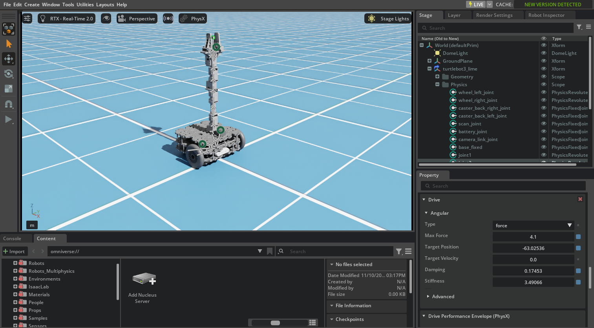
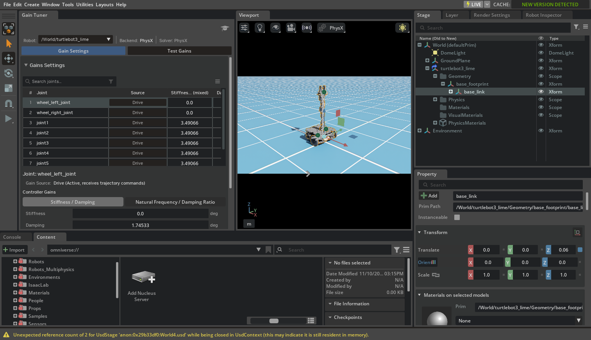
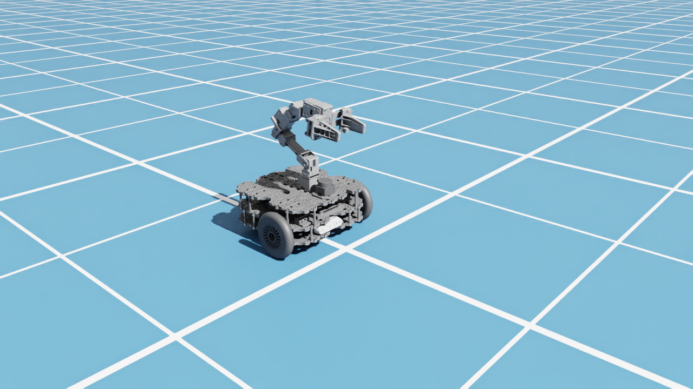

# 03 · Tune the robot

<p class="tutorial-meta">⏱ 25 min · Level: beginner → intermediate · Script: <code>isaac/03_tune_robot.py</code></p>

**Goal.** Make the imported Lime simulate well. The arm should hold its pose, the wheels should follow
velocity commands, the casters should slide, and the gripper should open and close. The tuning goes
into its own USD file, so a re-import never loses it.

<figure class="result" markdown>
<video controls autoplay loop muted playsinline>
  <source src="../../assets/video/tutorial03_tuned.mp4" type="video/mp4">
</video>
<figcaption>Tuned: the arm holds the folded "home" pose, the robot drives 0.87 m in 3 s at 5 rad/s (ideal 0.90 m), and the gripper opens.</figcaption>
</figure>

## Concepts

### Joint drives

Every movable joint has a **drive**, a spring-damper that PhysX solves *implicitly*, so it stays stable even when stiff:

$$
\tau = k_p\,(q_{target} - q) + k_d\,(\dot q_{target} - \dot q), \qquad |\tau| \le \tau_{max}
$$

| Use | stiffness $k_p$ | damping $k_d$ | target |
|---|---|---|---|
| **Position control** (arm, gripper) | > 0 | > 0 | position |
| **Velocity control** (wheels) | **0** | > 0 | velocity |

$\tau_{max}$ is **Max Force**. The importer took it from the URDF `effort` limits (wheels 3 N·m, arm 1 N·m)
but left stiffness and damping at 0, which is why everything was limp in tutorial 02.

!!! warning "Units: USD stores angular gains *per degree*"
    In the Property panel and in the `.usda` file, revolute stiffness is **N·m/deg** and damping is
    **N·m·s/deg**. Isaac Sim's Python APIs (`Articulation.set_dof_gains`) use **radians**.
    200 N·m/rad = 3.49 N·m/deg. The script converts with `gain * π / 180`.

### Friction and *combine modes*

Where two colliders touch, PhysX **combines** their friction coefficients. The default is the **average**.
Our casters are meant to slide, so they get friction 0. The floor (a ground plane with no physics
material of its own) uses PhysX's default material, which has friction > 0. The average of the two is
**not** 0. The caster pads carry the heavy battery at the back, and that friction brakes the robot.
Setting the caster material's combine mode to **min** makes its 0.0 win.

Measured on the final tuned asset (both wheels at 5 rad/s for 3 s, ideal distance 0.90 m):

| Caster material | Floor | Distance | Wheel speed |
|---|---|---|---|
| friction 0, combine *average* | default material | 0.67 m | 1.2 / 2.4 rad/s (and it curves) |
| friction 0, combine *average* | friction set to 0 | 0.87 m | 5.0 rad/s |
| friction 0, combine **min** | default material | **0.87 m** | **5.0 rad/s** |

The second row confirms the cause: removing friction at the caster–floor contact fixes the problem.
The third row fixes it without touching the floor.

### Wheel colliders: cylinder vs sphere

The URDF describes each tyre as a cylinder, 0.06 m radius and 24 mm wide. A cylinder touches the floor along a
**line** across its tread. When the robot turns, the inner and outer end of that line would need different
speeds, so the tyre scrubs and resists the turn. A **sphere** with the same radius touches the floor in one
**point**, which is the ideal wheel that the differential-drive formula (tutorial 06) assumes.

Measured: command 0.2 m/s and 0.5 rad/s, then read the robot's real yaw rate:

| Tyre collider | Wheel speeds (command 2.11 / 4.56 rad/s) | Yaw rate (command 0.5 rad/s) |
|---|---|---|
| cylinder (URDF) | 2.40 / 4.16 rad/s | 0.44 rad/s |
| **sphere** | **2.06 / 4.56 rad/s** | **0.50 rad/s** |

So the tuned asset switches the cylinder's collision off and adds an invisible sphere collider (`sphere_collider`,
purpose *guide*) to each wheel link. The visible tyre mesh is unchanged.

### Solver iterations

An articulation (the robot's joint tree) is solved iteratively. Raising the articulation's
**position iterations from 32 (default) to 64** made the drive test slightly more accurate:
0.847 m → 0.874 m in the run above. Keep **velocity iterations ≤ 4**. PhysX's TGS solver changed how it
treats more, and it prints a warning.

## The values

| What | Setting |
|---|---|
| Wheels (×2) | velocity drive: stiffness 0, damping 100 N·m·s/rad, max force 3 N·m (XM430-W210) |
| Arm joints (×6) | position drive: stiffness 200 N·m/rad, damping 10 N·m·s/rad, max force 4.1 N·m (XM430-W350 stall torque) |
| Arm start pose | the SRDF `home` pose `[0, -1.10, 1.85, 0, 0.98, 0]` rad, as both the drive target and the initial joint state (upstream uses 1.87 for `joint3`, which is outside its own URDF limit of 1.8567; MoveIt rejects that in tutorial 12) |
| Gripper (left) | position drive: stiffness 1000 N/m, damping 20 N·s/m, max force 10 N |
| Gripper (right) | no drive. It follows the left finger through its mimic joint |
| Tyres / casters | friction 1.0 (average) / friction 0.0 (**min**) |
| Tyre collision shape | **sphere**, r = 0.06 m, instead of the URDF cylinder |
| Articulation | 64 position / 4 velocity solver iterations |

## Tune it

=== "GUI"

    Start from the stage of tutorial 02 (robot referenced, `Physics = physx`, ground plane).

    **Drives.** In the Stage panel open `turtlebot3_lime ▸ Physics` and select a joint, for example `joint2`.
    In **Property ▸ Drive ▸ Angular** set *Stiffness*, *Damping* and *Max Force* (in **per-degree** units, see the table above).
    Set *Target Position* in **degrees**. Select several joints at once (Ctrl+click) to edit them together.

    { .full }

    **Gain Tuner.** **Tools ▸ Robotics ▸ Asset Editors ▸ Gain Tuner** shows all joints of the selected
    articulation in one table. It can also play test motions (sinusoids or steps) and plot how each
    joint follows them. Use it to see the effect of a gain before you commit to it.

    { .full }

    **Friction.** **Create ▸ Physics ▸ Physics Material** (rigid body). In its **Rigid Body Material** section
    set *Static/Dynamic Friction*. In its **Material (PhysX)** section set the *Friction Combine Mode* to `min`
    for the caster material. Then select each caster collider (`caster_back_*_link/box`) and choose the
    material in **Property ▸ Physics materials on selected models**. Do not use the *Materials on
    selected models* section: that one is for the visual look.

    **Sphere tyres** (these GUI steps describe what the script does; the script is the verified path).
    For each `wheel_*_link`: select its `cylinder` and untick **Collider ▸ Collision Enabled**.
    Then right-click the link and choose **Create ▸ Shape ▸ Sphere**. Set its *Radius* to `0.06` and *Purpose* to
    `guide` (not rendered). Add a collider with **Add ▸ Physics ▸ Collider** and bind the tyre physics material.

    **Solver.** Select `base_link` (the articulation root). In its **Articulation Root** / **PhysxArticulationAPI**
    properties set *Solver Position Iteration Count* = 64 and *Solver Velocity Iteration Count* = 4.

    **Save as an override layer.** Instead of editing the imported files, create a new stage and add the
    imported robot as a reference (**File ▸ Add Reference**). Make your edits there, then **File ▸ Save As**
    `assets/usd/turtlebot3_lime_tuned.usda`. Your edits are stored as *overs* on top of the
    reference. That is exactly what the script below produces.

=== "Python (standalone)"

    ```bash
    source scripts/isaac_env.sh
    python isaac/03_tune_robot.py --headless --test
    ```

    The script writes `assets/usd/turtlebot3_lime_tuned.usda`, a small layer that *references* the
    import and adds overrides. Then it loads that file and checks the result.

    ```python
    robot = stage.DefinePrim("/turtlebot3_lime", "Xform")
    robot.GetReferences().AddReference("./turtlebot3_lime/turtlebot3_lime.usda")
    robot.GetVariantSet("Physics").SetVariantSelection("physx")      # (1)!

    drive = UsdPhysics.DriveAPI.Apply(joint_prim, "angular")
    drive.CreateStiffnessAttr(200.0 * math.pi / 180.0)                # (2)!
    drive.CreateDampingAttr(10.0 * math.pi / 180.0)
    drive.CreateMaxForceAttr(4.1)
    drive.CreateTargetPositionAttr(math.degrees(home))                 # (3)!

    PhysxSchema.PhysxMaterialAPI.Apply(caster_material).CreateFrictionCombineModeAttr("min")
    ```

    1. Users of the tuned file no longer have to pick the physics variant.
    2. N·m/rad → N·m/deg.
    3. USD joint angles are in degrees too.

    ??? example "Full script: `isaac/03_tune_robot.py`"
        ```python
        --8<-- "isaac/03_tune_robot.py"
        ```

## Check the result

```text
[03] arm max error after 2 s : 0.013 rad
[03] distance in 3 s         : 0.874 m (ideal 0.90 m)
[03] gripper left / right    : 0.0190 / 0.0190 m (target 0.019)
[03][test] PASS
```

- The arm holds `home` against gravity to within 0.013 rad (< 1°).
- 5 rad/s × 0.06 m = 0.30 m/s, so 0.90 m in 3 s. The missing 2.6 cm is the acceleration phase.
- The right finger copies the left one exactly: the mimic joint works under PhysX.

{ .full }

!!! tip "Experiment"
    Change `ARM_DRIVE = dict(stiffness=200.0, ...)` to `stiffness=20.0` and re-run: the arm sags.
    Change the caster combine mode back to `"average"`: the robot covers only about 0.67 m, curves, and the
    distance test fails.

From now on every tutorial loads **`assets/usd/turtlebot3_lime_tuned.usda`**. In Python that is
`common.lime.add_lime()`.

**Next:** [04 · Move it from Python](04-hello-robot.md)
