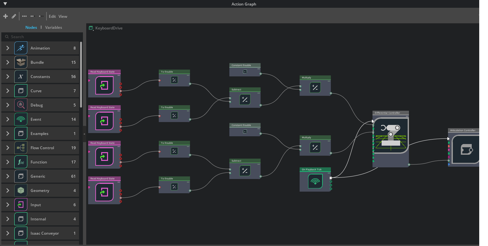

# 05 · Your first Action Graph: keyboard driving

<p class="tutorial-meta">⏱ 25 min · Level: beginner · Script: <code>isaac/05_action_graph.py</code></p>

**Goal.** Build an **Action Graph** (OmniGraph) that drives the Lime with the `W` `A` `S` `D` keys, without
writing a control loop. This is the same mechanism that connects Isaac Sim to ROS 2 in the following tutorials.

<figure class="result" markdown>
<video controls autoplay loop muted playsinline>
  <source src="../../assets/video/tutorial05_action_graph.mp4" type="video/mp4">
</video>
<figcaption><code>W</code> held for 3 s, then <code>A</code> for 2 s.</figcaption>
</figure>

## Concepts

**OmniGraph** is Isaac Sim's visual programming system. Nodes have **inputs** and **outputs**, and wires carry data
between them. An **Action Graph** runs when an *event* fires. **On Playback Tick** fires once per simulation frame
while playing, and the white *exec* wires decide which nodes run.

The keyboard graph turns key states into wheel speeds:

$$
v = 0.2\,\tfrac{m}{s}\cdot(W - S), \qquad \omega = 0.8\,\tfrac{rad}{s}\cdot(A - D)
$$

A held key reads 1, a released key 0. So `W` alone gives $v = 0.2$ m/s, and `S` alone gives $-0.2$ m/s.

{ .full }

## Build it

=== "GUI"

    1. Open a stage with the robot (tutorial 01, or `assets/usd/turtlebot3_lime_tuned.usda` plus a ground plane).
    2. **Window ▸ Visual Scripting ▸ Action Graph ▸ New Action Graph**.
    3. Type into the node search on the left and drag in:
       4 × **Read Keyboard State** (set *key* to `W`, `S`, `A`, `D`), 4 × **To Double**, 2 × **Subtract**,
       2 × **Constant Double** (`0.2` and `0.8`), 2 × **Multiply**, **Differential Controller**,
       **Articulation Controller**, **On Playback Tick**.
    4. Wire them as in the picture: W and S into one Subtract (`a` − `b`), A and D into the other; each
       difference × its constant; the products into the Differential Controller's *linearVelocity* and
       *angularVelocity*; *velocityCommand* → Articulation Controller; *tick* → both controllers' *execIn*.
    5. Differential Controller: *wheelRadius* `0.06`, *wheelDistance* `0.29425`. Articulation Controller:
       *targetPrim* = `…/Geometry/base_footprint/base_link`, *jointNames* = `wheel_left_joint`, `wheel_right_joint`.
    6. **Play**, click into the viewport, drive.

    !!! tip "Shortcut"
        **Tools ▸ Robotics ▸ OmniGraph Controllers ▸ Differential Controller** creates the controller part of this graph.

=== "Python (standalone)"

    ```bash
    source scripts/isaac_env.sh
    python isaac/05_action_graph.py
    ```

    `og.Controller.edit()` does what you did by hand: create nodes, set values, connect ports:

    ```python
    og.Controller.edit(
        {"graph_path": "/World/KeyboardDrive", "evaluator_name": "execution"},
        {
            keys.CREATE_NODES: [("KeyW", "omni.graph.nodes.ReadKeyboardState"), ...],
            keys.SET_VALUES:   [("KeyW.inputs:key", "W"), ...],
            keys.CONNECT:      [("KeyW.outputs:isPressed", "ToDoubleW.inputs:value"), ...],
        },
    )
    ```

    ??? example "Full script: `isaac/05_action_graph.py`"
        ```python
        --8<-- "isaac/05_action_graph.py"
        ```

## Automatic check

`--test` presses the keys from the script through Kit's input system, so the full graph (keyboard node → … →
wheels) runs exactly as when you type:

```text
[05][check] ok   W held for 3 s: drove 0.60 m (expected ~0.6)
[05][check] ok   A held for 2 s: turned left to 87 deg (expected ~90)
[05][test] PASS
```

| Node type ID (Python) | Name in the GUI |
|---|---|
| `omni.graph.action.OnPlaybackTick` | On Playback Tick |
| `omni.graph.nodes.ReadKeyboardState` | Read Keyboard State |
| `omni.graph.nodes.ToDouble` / `Subtract` / `Multiply` / `ConstantDouble` | To Double / Subtract / Multiply / Constant Double |
| `isaacsim.robot.wheeled_robots.DifferentialController` | Differential Controller |
| `isaacsim.core.nodes.IsaacArticulationController` | Articulation Controller |

**Next:** [06 · Drive with ROS 2](06-ros2-drive.md). Same graph, but the speeds come from `/cmd_vel`.
