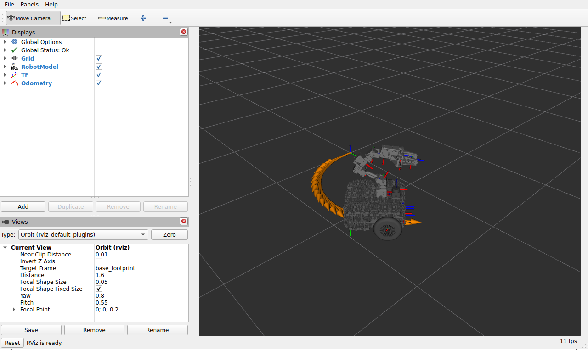
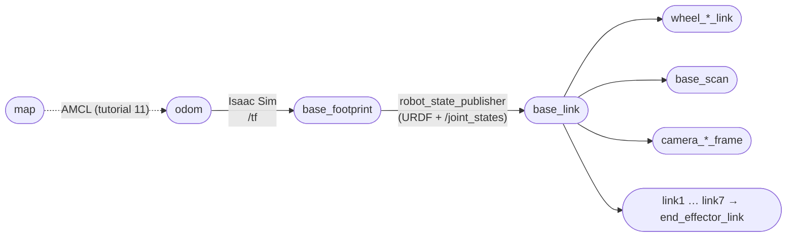
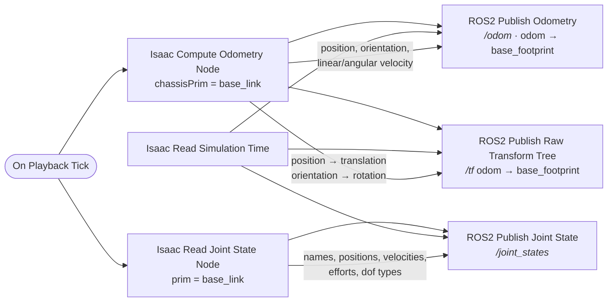

# 07 · Odometry, TF and RViz

<p class="tutorial-meta">⏱ 25 min · Level: beginner · Script: <code>isaac/07_odom_tf.py</code> · ROS: <code>lime_isaac_bringup/view_robot.launch.py</code></p>

**Goal.** Publish everything ROS needs to know *where the robot is* and *what its joints are doing*:
`/odom`, the TF transform `odom → base_footprint`, and `/joint_states`. Then see the Lime move in **RViz**.

<figure class="result" markdown>
{ .full }
<figcaption>RViz in the ROS 2 container: the robot model (posed from Isaac Sim's <code>/joint_states</code>), TF axes, and the odometry arrows of a left turn.</figcaption>
</figure>

## Concepts

**TF** is ROS's tree of coordinate frames. For a mobile robot it looks like this:



- **`odom → base_footprint`** is how far the robot has driven since it started. Isaac Sim publishes it,
  because Isaac Sim is the robot.
- **Everything below `base_footprint`** comes from the URDF. `robot_state_publisher` (in the ROS container)
  reads the URDF and `/joint_states` and publishes those transforms. This is exactly how a real robot works,
  so the same ROS launch files work in simulation and on the real Lime.

!!! info "Who publishes what"
    | Topic / transform | Publisher |
    |---|---|
    | `/clock` | Isaac Sim |
    | `/odom` (`nav_msgs/Odometry`) | Isaac Sim |
    | `/tf` `odom → base_footprint` | Isaac Sim |
    | `/joint_states` | Isaac Sim, for all 10 joints (until tutorial 12, where ros2_control takes over) |
    | `/tf` `base_footprint → …`, `/robot_description` | `robot_state_publisher` (ROS) |

## The graph



The clock and `/cmd_vel` graphs from [tutorial 06](06-ros2-drive.md) stay as they are.

## Build it

=== "GUI"

    1. Start from your stage of tutorial 06 (robot + clock + drive graph).
    2. Create a new Action Graph (**Window ▸ Visual Scripting ▸ Action Graph ▸ New Action Graph**) and add the nodes
       of the diagram above. Set:

        | Node | Input | Value |
        |---|---|---|
        | Isaac Compute Odometry Node | chassisPrim | `…/Geometry/base_footprint/base_link` |
        | ROS2 Publish Odometry | topicName / odomFrameId / chassisFrameId | `/odom` / `odom` / `base_footprint` |
        | ROS2 Publish Raw Transform Tree | parentFrameId / childFrameId | `odom` / `base_footprint` |
        | Isaac Read Joint State Node | prim | `…/Geometry/base_footprint/base_link` |
        | ROS2 Publish Joint State | topicName | `/joint_states` |

    3. Connect `Isaac Read Joint State Node` → `ROS2 Publish Joint State` port by port: `jointNames`, `jointPositions`,
       `jointVelocities`, `jointEfforts`, `jointDofTypes`, `stageMetersPerUnit`, and `execOut → execIn`.
    4. Press **Play**.

    !!! tip "Shortcut"
        **Tools ▸ Robotics ▸ ROS 2 OmniGraphs ▸ Odometry Publisher** and **▸ Joint States** build similar graphs from a form.

    !!! note "Why `Isaac Read Joint State` and not `targetPrim` on the publisher?"
        In Isaac Sim 6.x, `ROS2 Publish Joint State`'s own `targetPrim` input is deprecated. The supported way is to
        read the joints with `Isaac Read Joint State Node` and feed the arrays into the publisher.

=== "Python (standalone)"

    ```bash
    source scripts/isaac_env.sh
    python isaac/07_odom_tf.py
    ```

    The script reuses the tutorial 06 graphs and adds the new one. All three graph builders are in
    `isaac/common/graphs.py`:

    ```python
    graphs.enable_ros2_realtime(simulation_app)
    graphs.create_clock_graph()                                   # /clock          (06)
    graphs.create_drive_graph(articulation_root)                  # /cmd_vel        (06)
    graphs.create_odom_tf_joint_states_graph(articulation_root)   # /odom /tf /joint_states (new)
    ```

    ??? example "`create_odom_tf_joint_states_graph()` in `isaac/common/graphs.py`"
        ```python
        --8<-- "isaac/common/graphs.py:create_odom_tf_joint_states_graph"
        ```

    ??? example "Full script: `isaac/07_odom_tf.py`"
        ```python
        --8<-- "isaac/07_odom_tf.py"
        ```

## See it in RViz

First build the ROS 2 workspace once. It contains the Lime description and this project's launch files:

```bash
./scripts/build_ws.sh
```

With the simulation playing:

```bash
./docker/run_ros.sh ros2 launch lime_isaac_bringup view_robot.launch.py
```

This starts `robot_state_publisher` (with `use_sim_time: true`) and RViz with the config
`lime_isaac_bringup/rviz/view_robot.rviz`: fixed frame `odom`, RobotModel, TF and Odometry displays.
Now drive with `teleop_twist_keyboard` (tutorial 06) and watch the odometry trail.

Check the whole TF chain from the command line:

```bash
./docker/run_ros.sh ros2 run tf2_ros tf2_echo odom end_effector_link
```

```text
At time 19.916666666
- Translation: [0.338, 0.604, 0.312]
- Rotation: in Quaternion (xyzw) [0.631, -0.429, -0.534, -0.364]
```

<figure class="result" markdown>
<video controls autoplay loop muted playsinline>
  <source src="../../assets/video/tutorial07_odom_tf.mp4" type="video/mp4">
</video>
<figcaption>The self-check drives 0.2 m/s and 0.5 rad/s for 4 s.</figcaption>
</figure>

## Automatic check

`python isaac/07_odom_tf.py --headless --test` publishes `/cmd_vel` itself and compares what comes back
on `/odom` with the command and with the true pose in the simulation:

```text
[07][check] ok   odom twist v=0.199 m/s (cmd 0.2)
[07][check] ok   odom twist w=0.505 rad/s (cmd 0.5)
[07][check] ok   left turn -> yaw increased: odom yaw 106.6 deg
[07][check] ok   odom pose vs truth: |dxy|=0.003 m, dyaw=-0.48 deg
[07][check] ok   /joint_states has all 10 joints
[07][check] ok   TF odom -> base_footprint received
[07][test] PASS
```

!!! example "Why the turn rate matches"
    The first version of this check failed: the robot turned at 0.44 rad/s instead of 0.5. The tyre collider was the
    URDF's wide cylinder, which scrubs in turns. [Tutorial 03](03-tune-robot.md#wheel-colliders-cylinder-vs-sphere) now
    gives the wheels sphere colliders. That is one reason to compare simulation data with the command, not only
    "did it move?".

## Troubleshooting

| Symptom | Fix |
|---|---|
| RViz: *No transform from [base_link] to [odom]* | Is the simulation playing? Is `robot_state_publisher` running with `use_sim_time:=true`? |
| RobotModel is grey / arm in the wrong pose | `/joint_states` missing: check `ros2 topic hz /joint_states`. |
| TF time jumps / "TF_OLD_DATA" warnings | You restarted the simulation; restart RViz (sim time went back to 0). |

**Next:** camera, LiDAR and IMU (coming next).
