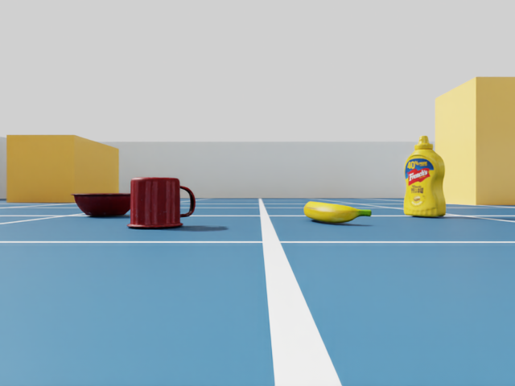
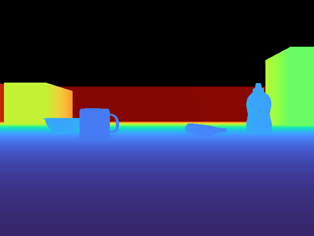
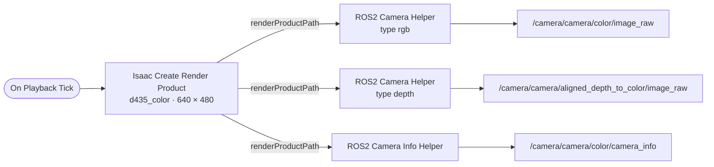

# 08 · Camera (RealSense D435)

<p class="tutorial-meta">⏱ 25 min · Level: beginner · Script: <code>isaac/08_camera.py</code></p>

**Goal.** Give the Lime its RealSense D435 camera, at the exact frame from the URDF. Publish RGB images,
depth images and the camera intrinsics on ROS 2, using the topic names the real robot's `realsense2_camera`
driver uses.

<div class="grid" markdown>

{ .full }

{ .full }

</div>

*Left: `/camera/camera/color/image_raw`. Right: `/camera/camera/aligned_depth_to_color/image_raw` (32-bit float metres),
coloured for display. The robot stands in the "lime_room", in front of a cup, a bowl, a banana and a bottle.*

## Concepts

**The lime_room.** From this tutorial on, the robot lives in a small room (`isaac/common/scene.py`): 6 × 5 m,
0.6 m walls, three orange obstacles, and four everyday objects from NVIDIA's asset library on the floor. The
same file can save the room as `assets/scenes/lime_room.usda` for the GUI (`python isaac/common/scene.py`).

**Where the camera is.** The URDF already contains the D435's frames. We put a USD camera at
`camera_color_optical_frame`, which is **5.8 cm above the floor**, at the front of the base, looking forward.

!!! info "Optical frames vs. USD cameras"
    A ROS *optical* frame looks along **+Z** with **+Y down** (image rows grow downwards). A USD camera looks
    along **−Z** with **+Y up**. A **180° rotation about X** turns one into the other, so the camera prim sits
    under `camera_color_optical_frame` with `rotateX = 180`.

**Matching the real camera.** The URDF says 640 × 480 and a horizontal field of view of 1.211 rad (69.4°).
A USD camera uses a pinhole model: focal length $f$ and aperture width $w$ (in mm) give the field of view
$\text{FOV} = 2\arctan\frac{w}{2f}$. With the default $w = 20.955$ mm that is $f = 15.1$ mm. The published
`camera_info` then has $f_x = 640 / (2\tan(1.211/2)) = 462.3$ px.

**Render product.** A camera produces images only through a *render product* (camera + resolution).
`Isaac Create Render Product` makes one. The ROS helpers read RGB, depth and intrinsics from it.

## The graph



All three use `frameId = camera_color_optical_frame`, so RViz and other ROS tools place the image correctly.

## Build it

=== "GUI"

    1. Open the room and add the robot: **File ▸ Open** `assets/scenes/lime_room.usda` (create it once with
       `python isaac/common/scene.py`), then **File ▸ Add Reference** `assets/usd/turtlebot3_lime_tuned.usda` at `/World/turtlebot3_lime`.
    2. Select `…/camera_color_frame/camera_color_optical_frame`, right-click and choose **Create ▸ Camera**.
       Name it `d435_color`. In **Property** set: *Transform ▸ Rotate* = (180, 0, 0), *Focal Length* = 15.1,
       *Horizontal Aperture* = 20.955, *Vertical Aperture* = 15.716, *Clipping Range* = (0.05, 20).
    3. Look through it: viewport camera menu (**Perspective ▾**) ▸ `d435_color`.
    4. **Tools ▸ Robotics ▸ ROS 2 OmniGraphs ▸ Camera** builds the graph above from a form. Set the camera prim,
       resolution 640 × 480, frame ID `camera_color_optical_frame`, and the topic names from the diagram.
    5. Press **Play**.

=== "Python (standalone)"

    ```bash
    source scripts/isaac_env.sh
    python isaac/08_camera.py
    ```

    ```python
    camera_path = sensors.add_d435_camera(robot_path)        # USD camera at camera_color_optical_frame
    graphs.create_camera_graph(camera_path, 640, 480)        # RGB + depth + camera_info
    ```

    ??? example "`add_d435_camera()` in `isaac/common/sensors.py`"
        ```python
        --8<-- "isaac/common/sensors.py:add_d435_camera"
        ```

    ??? example "`create_camera_graph()` in `isaac/common/graphs.py`"
        ```python
        --8<-- "isaac/common/graphs.py:create_camera_graph"
        ```

    ??? example "Full script: `isaac/08_camera.py`"
        ```python
        --8<-- "isaac/08_camera.py"
        ```

## Look at it from ROS 2

```bash
./docker/run_ros.sh ros2 run rqt_image_view rqt_image_view /camera/camera/color/image_raw
./docker/run_ros.sh ros2 topic hz /camera/camera/color/image_raw
./docker/run_ros.sh ros2 topic echo /camera/camera/color/camera_info --once
```

Or use RViz with the camera panel: `ros2 launch lime_isaac_bringup view_sensors.launch.py` (see [tutorial 09](09-lidar-imu.md)).

<figure class="result" markdown>
<video controls autoplay loop muted playsinline>
  <source src="../../assets/video/tutorial08_camera.mp4" type="video/mp4">
</video>
</figure>

## Automatic check

`python isaac/08_camera.py --headless --test` subscribes to its own topics:

```text
[08][check] ok   rgb 640x480 rgb8
[08][check] ok   rgb rate 60.0 Hz (sim time)
[08][check] ok   depth 32FC1, centre distance 3.94 m
[08][check] ok   camera_info fx=462.3 (expected 462.3 from the 69.4 deg FOV)
[08][check] ok   frame_id camera_color_optical_frame
[08][test] PASS
```

The 3.94 m centre distance is the far wall: x = 4.0 m, minus the camera's own x position of 0.059 m.

!!! note "Publish rate"
    Camera helpers publish every rendered frame (here 60 Hz). In Isaac Sim 6.x the per-sensor rate is set by the
    `omni:sensor:tickRate` attribute; `frameSkipCount` on the helper nodes is deprecated.

**Next:** [09 · LiDAR & IMU](09-lidar-imu.md)
