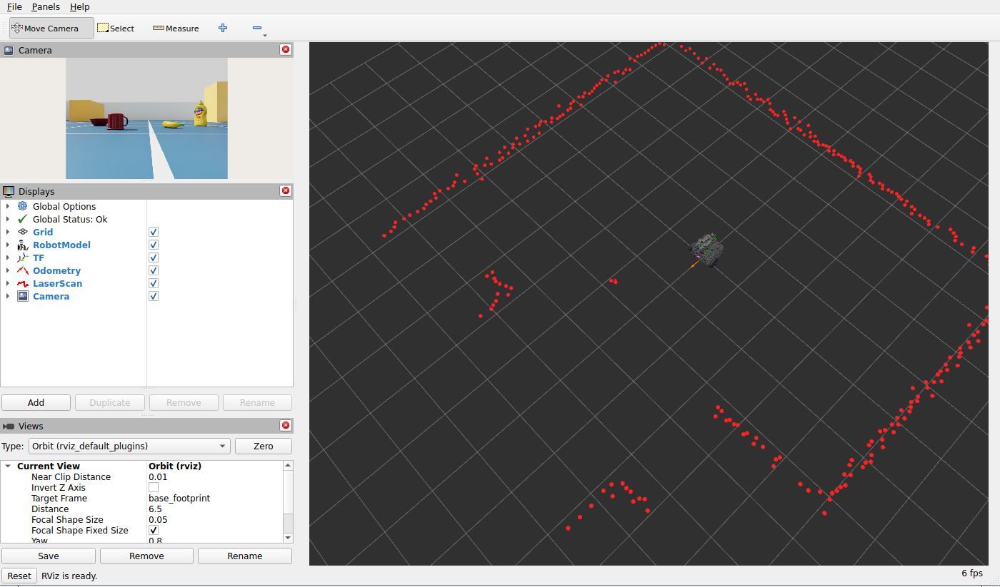
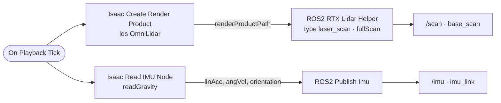

# 09 · LiDAR & IMU

<p class="tutorial-meta">⏱ 25 min · Level: beginner · Script: <code>isaac/09_lidar_imu.py</code> · ROS: <code>lime_isaac_bringup/view_sensors.launch.py</code></p>

**Goal.** Add the Lime's **LDS-01 2D LiDAR** as an RTX LiDAR, configured with the real sensor's numbers, and the
**IMU**. Publish `/scan` and `/imu`, then look at everything in RViz.

<figure class="result" markdown>
{ .full }
<figcaption>RViz (<code>view_sensors.launch.py</code>): the camera image (top left) and <code>/scan</code> (red), outlining the walls, the three obstacles and the bottle. The bottle is the only object taller than the LiDAR's 16 cm scan plane.</figcaption>
</figure>

## Concepts

**RTX LiDAR.** Isaac Sim simulates LiDARs by ray tracing the scene on the GPU, with real scan patterns, timing
and noise. Sensor models live in Isaac Sim's sensor library (`Lidar.create(config=...)`), and every parameter is
a USD attribute on an `OmniLidar` prim.

**Making it an LDS-01.** The Lime's URDF says the LDS-01 measures **360 points per turn at 5 Hz, 0.12–3.5 m**.
We start from the single-beam `RPLIDAR_S2E` model and override its numbers:

| Attribute | Value | Why |
|---|---|---|
| `omni:sensor:Core:scanRateBaseHz`, `omni:sensor:tickRate` | 5 | 5 turns per second |
| `omni:sensor:Core:patternFiringRateHz`, `reportRateBaseHz` | 1800 | 1800 shots/s ÷ 5 turns/s = 360 points per turn |
| `omni:sensor:Core:nearRangeM` / `farRangeM` | 0.12 / 3.5 | range limits; 0.12 m also ignores hits on the robot's own folded arm |

The RPLIDAR housing mesh is hidden; the Lime's own LDS mesh is already there.

**IMU.** A physics sensor that reads the acceleration and angular velocity of the rigid body it is attached to.
It must sit on a rigid body. `imu_link` is only a frame without mass, so the IMU goes on `base_link`, 33 mm up
(where `imu_link` is). It publishes with `frame_id = imu_link`.

## The graphs



## Build it

=== "GUI"

    1. Start from the stage of tutorial 08 (lime_room + robot + camera).
    2. **LiDAR:** select `…/base_link/base_scan`, then **Create ▸ Sensors ▸ RTX Lidar ▸ Slamtec ▸ RPLIDAR S2E**.
       Select the created `OmniLidar` prim and set the attributes from the table above in **Property ▸ Raw USD Properties**.
    3. **Tools ▸ Robotics ▸ ROS 2 OmniGraphs ▸ RTX Lidar**: choose the LiDAR prim, type *laser_scan*,
       topic `/scan`, frame `base_scan`.
    4. **IMU:** select `…/base_link`, then **Create ▸ Sensors ▸ Imu Sensor**. Set its translation to (0, 0, 0.033).
    5. Build the IMU graph by hand (Action Graph editor): `On Playback Tick` → `Isaac Read IMU Node`
       (*imuPrim* = the IMU, *readGravity* ✓) → `ROS2 Publish Imu` (*topicName* `/imu`, *frameId* `imu_link`). Connect
       `linAcc → linearAcceleration`, `angVel → angularVelocity`, `orientation → orientation`, and the simulation time to *timeStamp*.
    6. Press **Play**. With a window, the script also draws the LiDAR hits as red points in the viewport.

=== "Python (standalone)"

    ```bash
    source scripts/isaac_env.sh
    python isaac/09_lidar_imu.py
    ```

    ```python
    lidar_path = sensors.add_lds_lidar(robot_path)   # RTX LiDAR at base_scan, LDS-01 numbers
    graphs.create_lidar_graph(lidar_path)            # -> /scan
    imu_path = sensors.add_imu(robot_path)           # physics IMU on base_link
    graphs.create_imu_graph(imu_path)                # -> /imu
    ```

    ??? example "`add_lds_lidar()` and `add_imu()` in `isaac/common/sensors.py`"
        ```python
        --8<-- "isaac/common/sensors.py:add_lds_lidar"
        ```
        ```python
        --8<-- "isaac/common/sensors.py:add_imu"
        ```

    ??? example "`create_lidar_graph()` and `create_imu_graph()` in `isaac/common/graphs.py`"
        ```python
        --8<-- "isaac/common/graphs.py:create_lidar_graph"
        ```
        ```python
        --8<-- "isaac/common/graphs.py:create_imu_graph"
        ```

    ??? example "Full script: `isaac/09_lidar_imu.py`"
        ```python
        --8<-- "isaac/09_lidar_imu.py"
        ```

## Look at it from ROS 2

```bash
./docker/run_ros.sh ros2 launch lime_isaac_bringup view_sensors.launch.py   # RViz: robot, TF, /scan, camera
./docker/run_ros.sh ros2 topic hz /scan                                     # ~5 Hz
./docker/run_ros.sh ros2 topic echo /imu --once
```

<figure class="result" markdown>
<video controls autoplay loop muted playsinline>
  <source src="../../assets/video/tutorial09_lidar_imu.mp4" type="video/mp4">
</video>
<figcaption>The self-check turns the robot on the spot at 0.5 rad/s to test the IMU's gyroscope.</figcaption>
</figure>

## Automatic check

The robot stands at the room's origin, so the expected distances are known: side walls at y = ±2.5 m, back wall at
x = −2.0 m (from the LiDAR at x = 0.027 m that is 2.03 m), and the front wall at 3.97 m, beyond the 3.5 m range.

```text
[09][check] ok   scan: 360 beams, 1.00 deg apart
[09][check] ok   scan range limits 0.12 .. 3.50 m
[09][check] ok   scan rate 5.0 Hz (sim time)
[09][check] ok   left wall  (+90 deg) 2.49 m (expected 2.50)
[09][check] ok   right wall (-90 deg) 2.53 m (expected 2.50)
[09][check] ok   back wall  (180 deg) 2.06 m (expected 2.03)
[09][check] ok   front (0 deg): east wall at 3.97 m is beyond 3.5 m -> -1.0
[09][check] ok   imu at rest: acc z = 9.81 m/s^2 (gravity 9.81)
[09][check] ok   imu turning: gyro z = 0.49 rad/s (commanded 0.50)
[09][check] ok   frames base_scan / imu_link
[09][test] PASS
```

!!! note "The LiDAR is noisy, like a real one"
    Single beams scatter by a few centimetres (the sensor model's range accuracy is 3 cm). Around 180° one run
    read 1.97–2.10 m. The check therefore uses the **median of the beams within ±3°**, the same way you would
    test a real sensor.

!!! info "At rest the IMU reads +9.81 m/s² upwards"
    An accelerometer measures *specific force*: standing still, the floor pushes the robot up against gravity.
    That is why `readGravity` is on; a real IMU behaves the same.

**Next:** Object detection with YOLO (coming next).
