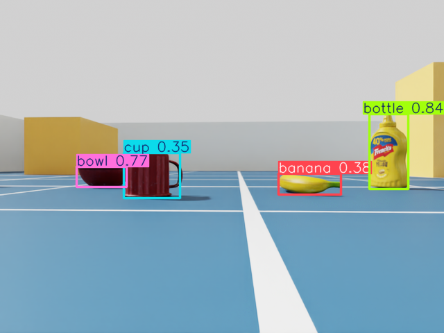
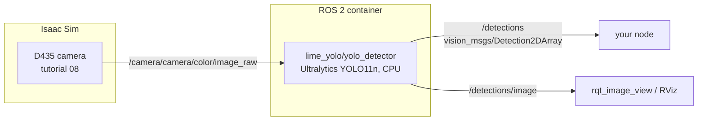

# 10 · Object detection with YOLO

<p class="tutorial-meta">⏱ 20 min · Level: beginner · Script: <code>isaac/10_yolo.py</code> · ROS: <code>lime_yolo</code></p>

**Goal.** Detect everyday objects in the Lime's camera images with **YOLO**. The detector is an ordinary ROS 2 node:
it does not know, or care, that the images come from a simulator.

<figure class="result" markdown>
{ .full }
<figcaption><code>/detections/image</code>: YOLO11n finds the bowl, the cup, the banana and the bottle that tutorial 08's camera sees.</figcaption>
</figure>

## Concepts



- **YOLO** ("You Only Look Once") is a family of real-time object detectors. The pretrained models know the
  80 everyday classes of the COCO dataset: *cup, bowl, banana, bottle, chair, person, …*. The lime_room
  objects were chosen from those classes.
- **`vision_msgs/Detection2DArray`** is the standard ROS message for 2D detections: one entry per object, with
  its box (centre and size in pixels) and a class name with a score.
- The node processes only the **newest** image, at most 5 times per second. On a CPU that is enough for a
  demo, and the simulation never waits for it.

!!! warning "License"
    The tutorial code is Apache-2.0. **Ultralytics YOLO is AGPL-3.0**: it is installed in the Docker image and the
    model weights are downloaded at first use (to `~/.cache/lime_yolo` in the container). Neither is part of this
    repository. Check the license before you use it in a product. NVIDIA's
    [Isaac ROS `isaac_ros_yolov8`](https://nvidia-isaac-ros.github.io/repositories_and_packages/isaac_ros_object_detection/isaac_ros_yolov8/index.html)
    is a GPU-accelerated (TensorRT) alternative for advanced users.

## Run it

Terminal 1, Isaac Sim (the same scene as tutorial 08):

```bash
source scripts/isaac_env.sh
python isaac/10_yolo.py
```

Terminal 2, the detector (the first start downloads `yolo11n.pt`, about 6 MB):

```bash
./scripts/build_ws.sh lime_yolo        # once
./docker/run_ros.sh ros2 launch lime_yolo yolo.launch.py
```

```text
[yolo_detector]: loaded yolo11n.pt: 80 classes
[yolo_detector]: 3 objects: bottle 0.81, cup 0.68, bowl 0.67
```

Terminal 3, look at the results:

```bash
./docker/run_ros.sh ros2 run rqt_image_view rqt_image_view /detections/image
./docker/run_ros.sh ros2 topic echo /detections --field detections
```

Drive the robot around with `teleop_twist_keyboard` (tutorial 06) and watch the detections change.

!!! tip "Bigger model, other settings"
    `ros2 launch lime_yolo yolo.launch.py model:=yolo11s.pt confidence:=0.5 max_rate:=10.0`. Larger models are
    more accurate and slower.

??? example "The detector node: `lime_yolo/yolo_detector.py`"
    ```python
    --8<-- "ros2_ws/src/lime_yolo/lime_yolo/yolo_detector.py"
    ```

??? example "Isaac Sim side: `isaac/10_yolo.py`"
    ```python
    --8<-- "isaac/10_yolo.py"
    ```

## Automatic check

`python isaac/10_yolo.py --headless --test` listens to `/detections` (Isaac Sim's own rclpy has `vision_msgs`) and
passes when at least 3 of the 4 placed objects are detected. Start the detector in the container while it runs
(`tools/run_all_checks.sh 10` does both):

```text
[10][check] ok   detected 'banana' (best score 0.39)
[10][check] ok   detected 'bottle' (best score 0.86)
[10][check] ok   detected 'bowl' (best score 0.78)
[10][check] ok   detected 'cup' (best score 0.77)
[10][check] other classes reported: ['frisbee']
[10][test] 4/4 objects detected: PASS
```

!!! example "Sim-to-real: what the scores tell you"
    The bottle and the bowl are detected with high confidence. The banana and the cup get lower scores, and the
    flat red bowl is sometimes taken for a *frisbee*. The camera is only 5.8 cm above the floor, so it sees the
    objects from an unusual angle, and the COCO photos rarely show them that way. A real robot has the same
    problem. Simulation lets you see it, and generate training images for it, before the robot exists.

**Next:** [11 · Navigation with Nav2](11-nav2.md)
