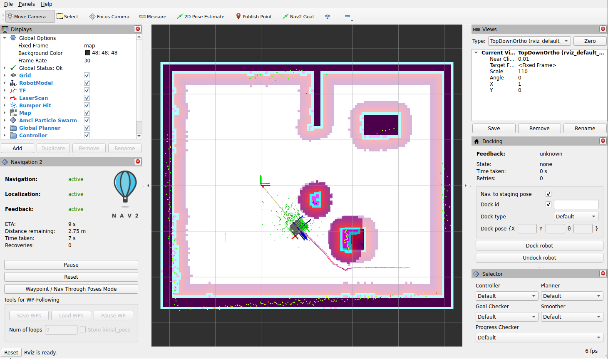
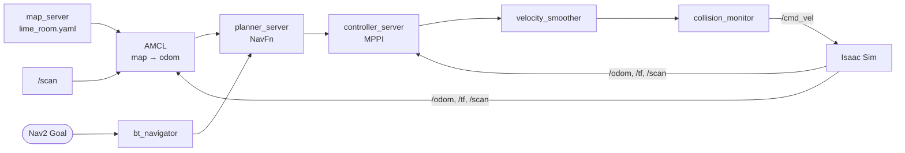
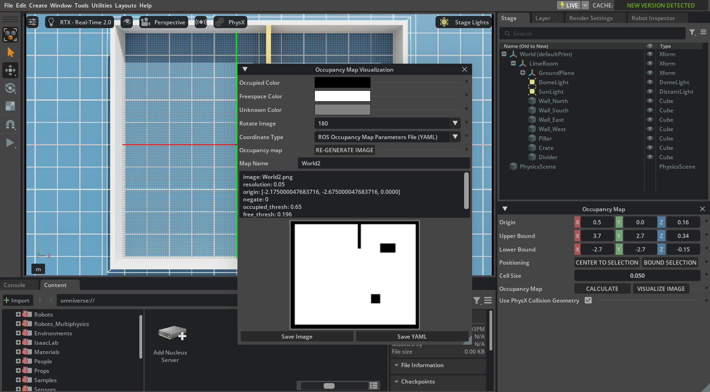
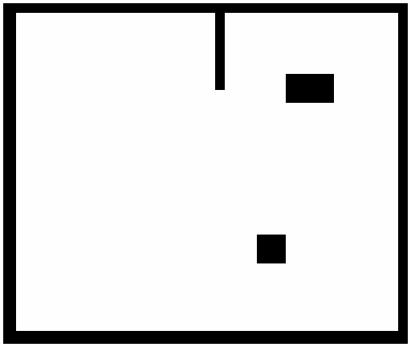

# 11 · Navigation with Nav2

<p class="tutorial-meta">⏱ 40 min · Level: intermediate · Scripts: <code>isaac/11_make_map.py</code>, <code>isaac/11_nav2.py</code> · ROS: <code>lime_isaac_bringup/navigation.launch.py</code></p>

**Goal.** Make a map of the lime_room with Isaac Sim, then let **Nav2**, the ROS 2 navigation stack, drive the
Lime to a goal: localise with AMCL, plan around obstacles, follow the path.

<figure class="result" markdown>
<video controls autoplay loop muted playsinline>
  <source src="../../assets/video/tutorial11_nav2.mp4" type="video/mp4">
</video>
<figcaption>Nav2 drives the Lime from (0, 0) to (3.2, −1.8). The traffic cone is not in the map, but the LiDAR sees it: the robot goes round it and the pillar, 3.96 m in 25 s, without touching anything.</figcaption>
</figure>

{ .full }

*RViz (`navigation.rviz`): the map, the costmaps (pink = inflated obstacles, including the traffic cone that only
the LiDAR knows about), AMCL's particles (green), the LiDAR scan (red dots), and the planned path (pink line) round
the cone and the pillar. The **Nav2 Goal** button in the toolbar sends goals.*

## Concepts

Nav2 needs four things from the robot. Isaac Sim provides all of them, built in tutorials 06–09:

| Nav2 needs | Topic | Tutorial |
|---|---|---|
| a clock | `/clock` | 06 |
| a way to drive | `/cmd_vel` (Nav2 publishes, Isaac Sim's graph subscribes) | 06 |
| odometry and TF `odom → base_footprint` | `/odom`, `/tf` | 07 |
| the robot's frames | `/joint_states` → `robot_state_publisher` | 07 |
| a laser scan | `/scan` | 09 |

…plus a **map**, which is new in this tutorial.

!!! note "The map is for what stays put. The costmaps see what's new"
    The map holds the walls, the pillar, the crate and the divider: the things that stay put. The objects of
    tutorials 08–10 are cleared away. Instead, `11_nav2.py` puts a **traffic cone** from NVIDIA's warehouse props
    right on the robot's way, *after* the map was made, so the map doesn't know about it. The LiDAR sees it, the
    costmaps' obstacle layers mark it, and the planner goes round it, just as it would go round a box someone
    left on the floor.

    The cone is 46 cm tall. The LiDAR only sees what crosses its plane, 16 cm above the floor: a banana (4 cm)
    would be invisible to it (tutorial 09). Real robots add a depth camera to the costmaps for low obstacles.

    ??? example "`add_traffic_cone()` in `isaac/common/scene.py`"
        ```python
        --8<-- "isaac/common/scene.py:add_traffic_cone"
        ```



## Part 1: make the map

Nav2 localises against an *occupancy grid*: an image in which black means occupied, white means free and grey
means unknown, plus a YAML file with its resolution and origin. On a real robot you would drive around with SLAM
([tutorial 14](14-slam.md)).
In simulation the scene *is* the ground truth, so Isaac Sim can compute the map directly from the colliders.

The generator looks at a **height band** of the scene and flattens it into one 2D map. We use 1–50 cm above the
floor: high enough to skip the floor itself, and above the top of every obstacle. The floor is cleared first: a map
is for what stays put.

=== "GUI"

    1. Open `assets/scenes/lime_room.usda` (without the robot).
    2. Clear the floor: in the **Stage** panel, select `/World/LimeRoom/Objects` and press **Delete**. Don't save
       the scene afterwards: tutorials 08–10 and 13 need the objects.
    3. **Tools ▸ Robotics ▸ Occupancy Map**.
    4. *Origin*: a free point, (0.5, 0, 0.16). *Lower Bound* (−2.7, −2.7, **−0.15**) and *Upper Bound*
       (3.7, 2.7, **0.34**), relative to the origin: the band from 1 cm to 50 cm above the floor. *Cell Size* 0.05.
    5. **CALCULATE**, then **VISUALIZE IMAGE**, then **Save Image** and **Save YAML** in
       `ros2_ws/src/lime_isaac_bringup/maps/`.

    { .full }

    With these values the GUI computes the same map as the script. Keep **Rotate Image = 180** (the default),
    which puts north at the top. Set **Map Name** to `lime_room` before saving. Its YAML origin
    `[-2.175, -2.675]` differs from the script's `[-2.2, -2.7]` by half a cell (2.5 cm), and either works.

=== "Python (standalone)"

    ```bash
    source scripts/isaac_env.sh
    python isaac/11_make_map.py --headless --test
    ```

    ```python
    generator = _omap.Generator(omni.physx.get_physx_interface(), omni.usd.get_context().get_stage_id())
    generator.update_settings(0.05, 4.0, 5.0, 6.0)      # cell size, occupied / free / unknown values
    generator.set_transform((0.5, 0.0, 0.16), lo, hi)    # origin (a free point); bounds: x, y and the 1-50 cm band
    generator.generate2d()                               # needs the simulation playing (PhysX queries)
    occupied = generator.get_occupied_positions()        # world coordinates
    ```

    The script turns the occupied and free cells into `lime_room.pgm` and `lime_room.yaml`, with
    `origin: [-2.2, -2.7, 0.0]`, the world position of the bottom-left pixel. It checks known cells: a wall and the
    pillar must be occupied, the start, the room centre and the cone's spot free:

    ```text
    [11] generator: 1863 occupied, 11961 free cells
    [11] map 128 x 108 cells (6.40 x 5.40 m) -> ros2_ws/src/lime_isaac_bringup/maps
    [11][check] ok   north wall (1.0, 2.55) occupied
    [11][check] ok   pillar (2.0, -1.2) occupied
    [11][check] ok   robot start (0, 0) free
    [11][check] ok   room centre (1.0, -0.5) free
    [11][check] ok   where the cone will stand (1.2, -0.3) free (not in the map)
    [11][test] map PASS
    ```

    ??? example "Full script: `isaac/11_make_map.py`"
        ```python
        --8<-- "isaac/11_make_map.py"
        ```

{ width="420" }

*The map: the walls, the divider, the crate and the pillar, and nothing else. The traffic cone comes later (part 2).*

Because the map comes from the same coordinates as the simulation, map frame = world frame. The robot starts at
(0, 0) facing +x, and AMCL is told exactly that (`set_initial_pose: true`).

## Part 2: navigate

Terminal 1, Isaac Sim:

```bash
source scripts/isaac_env.sh
python isaac/11_nav2.py             # the lime_room with a traffic cone on the floor
```

Terminal 2, Nav2 + RViz:

```bash
./scripts/build_ws.sh lime_isaac_bringup     # once
./docker/run_ros.sh ros2 launch lime_isaac_bringup navigation.launch.py
```

Wait for `Managed nodes are active`, then click **Nav2 Goal** in RViz and drag an arrow on the map.
Or send the goal from the command line:

```bash
./docker/run_ros.sh ros2 action send_goal /navigate_to_pose nav2_msgs/action/NavigateToPose \
  "{pose: {header: {frame_id: map}, pose: {position: {x: 3.2, y: -1.8}, orientation: {w: 1.0}}}}"
```

**What the cone changes.** Restart Isaac Sim with `python isaac/11_nav2.py --no-cone` (and Nav2 too) and send the
same goal. Without the cone, Nav2 drives almost straight and passes north of the pillar. With the cone on that
line, it goes south of the cone and then south of the pillar. The map is the same both times; only the costmaps,
fed by the LiDAR, are different.

### The Lime's Nav2 parameters

`lime_isaac_bringup/config/nav2_params.yaml` is **generated from Jazzy's own** `nav2_bringup/params/nav2_params.yaml`,
with only these changes:

| Parameter | Value | Why |
|---|---|---|
| `robot_base_frame` (bt_navigator, costmaps, behaviours) | `base_footprint` | Isaac Sim publishes `odom → base_footprint` |
| costmap `footprint` | `[[0.075, 0.165], [0.075, -0.165], [-0.205, -0.165], [-0.205, 0.165]]` | the base box and the wheels; the base is not centred on the wheel axis |
| `inflation_radius` | 0.30 m | small room, small robot |
| AMCL `laser_min_range` / `laser_max_range`, costmap ranges | 0.12 / 3.5 m | LDS-01 |
| AMCL `set_initial_pose`, `initial_pose` | true, (0, 0, 0) | the robot's start in the map |
| `vx_max`, `wz_max`, velocity smoother limits | 0.3 m/s, 1.2 rad/s | gentle indoor speeds (the Lime can do about 0.48 m/s) |

!!! warning "Don't reuse Humble Nav2 parameter files on Jazzy"
    Jazzy changed plugin names (`::` instead of `/`), loads the default BT plugins itself, and starts extra servers
    (collision monitor, docking, route server) that need parameters. Starting from the distro's own file avoids
    all of that.

??? example "Isaac Sim side: `isaac/11_nav2.py`"
    ```python
    --8<-- "isaac/11_nav2.py"
    ```

## Automatic check

`python isaac/11_nav2.py --headless --test` waits until the robot's **ground-truth** position in Isaac Sim is
within 0.25 m of the goal (3.2, −1.8). `tools/run_all_checks.sh 11` starts Nav2 and sends the goal:

```text
[11] goal reached after 25.0 s (sim time), 0.25 m from the goal
[11][check] ok   robot reached (3.2, -1.8) within 0.25 m (ground truth); driven 3.96 m
[11][check] ok   cone not touched (moved 0.0 cm); closest approach of the robot's footprint to its centre: 58 cm
[11][test] PASS
```

The cone is a rigid body (1 kg), so the test also knows if the robot touched it: it would have moved.

## Troubleshooting

| Symptom | Fix |
|---|---|
| RViz: no map / *"Frame [map] does not exist"* | AMCL has no initial pose yet: wait for `Managed nodes are active`, or set one with **2D Pose Estimate**. |
| The robot spins, or does not move | Is the simulation playing, and is `/clock` published? Is only **one** simulation running? |
| The robot is mislocalised after you restart Isaac Sim | Restart Nav2 too: simulation time went back to 0. |
| Nav2 plans straight through the cone | The cone is only in the costmaps, which get it from `/scan`: is the LiDAR publishing? Anything lower than the scan plane (16 cm) is invisible to the LiDAR. |

**Next:** [12 · Arm control with MoveIt 2](12-moveit2.md)
