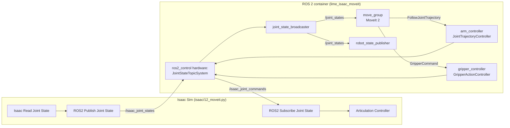
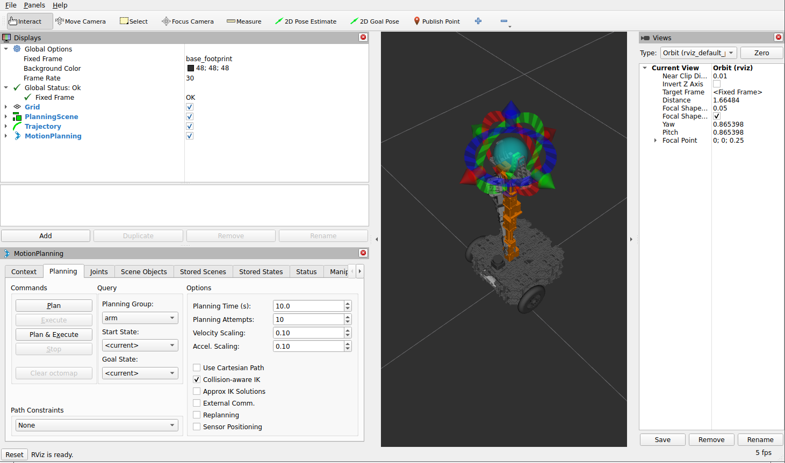

# 12 · Arm control with MoveIt 2

<p class="tutorial-meta">⏱ 40 min · Level: intermediate · Script: <code>isaac/12_moveit.py</code> · ROS: <code>lime_isaac_moveit</code></p>

**Goal.** Plan and execute arm motions for the Lime with **MoveIt 2**, and open and close the gripper.
ros2_control talks to Isaac Sim over two topics, exactly as it would talk to the real robot's hardware driver.

<figure class="result" markdown>
<video controls autoplay loop muted playsinline>
  <source src="../../assets/video/tutorial12_moveit.mp4" type="video/mp4">
</video>
<figcaption>MoveIt plans a motion from the folded <code>home</code> pose to a reaching pose and opens the gripper. Executed by ros2_control, simulated by Isaac Sim.</figcaption>
</figure>

## Concepts



- **ros2_control** is the standard ROS 2 layer between controllers and hardware. On the real Lime the
  *hardware component* talks to the Dynamixel servos. Here it is
  `joint_state_topic_hardware_interface/JointStateTopicSystem`: it reads joint states from a topic and
  writes joint commands to another topic. Isaac Sim is on the other side of those topics.
- **MoveIt 2** (`move_group`) plans collision-free trajectories with OMPL and sends them to `arm_controller`.
  Gripper goals go to `gripper_controller`.
- **One owner per topic.** From this tutorial on, Isaac Sim publishes `/isaac_joint_states`, and only
  `joint_state_broadcaster` publishes `/joint_states`. In tutorial 07 Isaac Sim published `/joint_states`
  directly, because there was no ros2_control yet.

## Isaac Sim side

=== "GUI"

    Start from the stage of tutorial 07. Then:

    1. In the tutorial 07 graph, change **ROS2 Publish Joint State ▸ topicName** to `/isaac_joint_states`.
    2. New Action Graph with: `On Playback Tick` → `ROS2 Subscribe Joint State` (*topicName* `/isaac_joint_commands`)
       → `Articulation Controller` (*targetPrim* = `…/base_link`). Connect `execOut → execIn`, `jointNames → jointNames`,
       and the `positionCommand`, `velocityCommand` and `effortCommand` outputs to the same-named inputs.
    3. Press **Play**.

=== "Python (standalone)"

    ```bash
    source scripts/isaac_env.sh
    python isaac/12_moveit.py
    ```

    ```python
    graphs.create_odom_tf_joint_states_graph(articulation_root, joint_states_topic="/isaac_joint_states")
    graphs.create_joint_command_graph(articulation_root)   # /isaac_joint_commands -> Articulation Controller
    ```

    ??? example "`create_joint_command_graph()` in `isaac/common/graphs.py`"
        ```python
        --8<-- "isaac/common/graphs.py:create_joint_command_graph"
        ```

    ??? example "Full script: `isaac/12_moveit.py`"
        ```python
        --8<-- "isaac/12_moveit.py"
        ```

## ROS side: plan in RViz

```bash
./scripts/build_ws.sh                      # once, if you have not built the workspace yet
./docker/run_ros.sh ros2 launch lime_isaac_moveit moveit.launch.py
```

In RViz's **MotionPlanning** panel: *Planning Group* `arm`, drag the interactive marker (or choose a
*Goal State* such as `home`), then click **Plan & Execute**. Watch the arm move in Isaac Sim.

{ .full }

## ROS side: plan from Python

`lime_isaac_moveit/scripts/arm_demo.py` sends a joint goal to MoveIt's `/move_action`
(`moveit_msgs/action/MoveGroup`, *plan and execute*), then a `control_msgs/action/GripperCommand`:

```bash
./docker/run_ros.sh ros2 run lime_isaac_moveit arm_demo                         # reach forward, open
./docker/run_ros.sh ros2 run lime_isaac_moveit arm_demo --pose home --gripper close
```

```text
[lime_arm_demo]: arm -> [0.0, -0.6, 0.3, 0.0, 1.2, 0.0]: SUCCESS
[lime_arm_demo]: gripper -> 0.019 m: reached=True stalled=False at 0.0174
```

??? example "`arm_demo.py`"
    ```python
    --8<-- "ros2_ws/src/lime_isaac_moveit/scripts/arm_demo.py"
    ```

## Porting the Lime's MoveIt config from Humble to Jazzy

The upstream `turtlebot3_lime_moveit_config` was written for Humble and real hardware. These are the
changes this tutorial needed. The first two come from the Jazzy migration notes; every other row was found by
running it:

| Symptom | Cause | Fix (in `lime_isaac_moveit`) |
|---|---|---|
| `planning_plugin` / `default_planner_request_adapters/*` not found | Jazzy renamed them | `ompl_planning.yaml` in Jazzy format: `planning_plugins`, `default_planning_request_adapters/*`, `default_planning_response_adapters/*` |
| `topic_based_ros2_control` not available on Jazzy | package renamed | `joint_state_topic_hardware_interface/JointStateTopicSystem` (same parameters) |
| `The requested state interface not found: 'wheel_left_joint/effort'`; hardware deactivated | Isaac Sim's JointState carries effort too, and the topic system copies every field | declare `position`, `velocity` **and** `effort` state interfaces |
| Arm never moves; Isaac Sim warns *"ensure size of position … arrays match the number of actuators"* | wheels (state only) and arm in one component: the command message had 9 names but 7 positions | two hardware components, `IsaacArm` (commands) and `IsaacWheels` (state only) |
| MoveIt: `Start state out of bounds … joint3` | SRDF `home` has `joint3 = 1.87` but the URDF limit is 1.8567 | `home` uses 1.85 |
| `No acceleration limit was defined for joint joint1` | Jazzy's time parameterization needs acceleration limits | own `joint_limits.yaml` with `max_acceleration` |
| "SUCCESS" although the arm did not move | without goal tolerances, a trajectory controller reports success when the time is over | `arm_controller.constraints.<joint>.goal: 0.05` |
| Gripper "stalled at 0.0" immediately | stall detection fired before the finger started | `stall_timeout: 2.0`, `stall_velocity_threshold: 0.0005` |

!!! warning "Only one simulation at a time"
    Two running Isaac Sim instances both publish `/clock`. Every ROS node then sees time jumping back and forth
    (*"Detected jump back in time. Clearing TF buffer."*), and plans fail in strange ways. Stop old runs with
    `tools/stop_isaac.sh`, and stop old ROS processes with `docker/ros_clean.sh`.

## Automatic check

`python isaac/12_moveit.py --headless --test` waits until the simulated arm reaches the `arm_demo` pose
(within 0.05 rad) and the gripper is open. That is the real joint state in Isaac Sim, not the controller's report:

```text
[12] arm reached the demo pose (max error 0.012 rad), gripper open 0.0154 m
[12][test] MoveIt plan executed in Isaac Sim: PASS
```

`tools/run_all_checks.sh 12` starts MoveIt and `arm_demo` in the container for you.

**Next:** [13 · Putting it all together](13-all-together.md)
