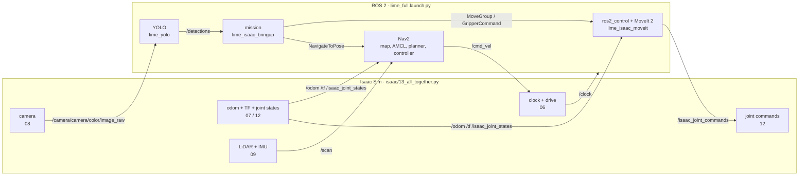

# 13 · Putting it all together

<p class="tutorial-meta">⏱ 30 min · Level: intermediate · Script: <code>isaac/13_all_together.py</code> · ROS: <code>lime_full.launch.py</code>, <code>mission</code></p>

**Goal.** Run the complete simulated TurtleBot3 Lime: every sensor and every graph from tutorials 06–12, plus
MoveIt 2, Nav2 and YOLO at the same time. Then run a small **mission** that uses all three.

<figure class="result" markdown>
<video controls autoplay loop muted playsinline>
  <source src="../../assets/video/tutorial13_all_together.mp4" type="video/mp4">
</video>
<figcaption>The mission: Nav2 to the far corner and back, YOLO looks at the objects, MoveIt points the arm at the bottle and folds it again.</figcaption>
</figure>

## The whole system



!!! info "One robot_state_publisher"
    `lime_full.launch.py` includes `lime_isaac_moveit/moveit.launch.py`, which brings the one and only
    `robot_state_publisher`. Its URDF also contains the ros2_control block. Nav2's bringup is included directly,
    without `navigation.launch.py`, so a second `robot_state_publisher` never starts. `/joint_states` comes only from
    `joint_state_broadcaster` (see [tutorial 12](12-moveit2.md)).

## Run it

Terminal 1, Isaac Sim:

```bash
source scripts/isaac_env.sh
python isaac/13_all_together.py
```

Terminal 2, the ROS 2 stack (wait for *"Managed nodes are active"* and *"You can start planning now!"*):

```bash
./scripts/build_ws.sh
./docker/run_ros.sh ros2 launch lime_isaac_bringup lime_full.launch.py
```

Terminal 3, the mission:

```bash
./docker/run_ros.sh ros2 run lime_isaac_bringup mission
```

```text
Nav2: going to the far corner (2.8, -1.8)
Nav2: reached the far corner
Nav2: going to the start (0.0, 0.0)
Nav2: reached the start
YOLO: I see a bottle (0.81), a bowl (0.85), a cup (0.78), a frisbee (0.52)
YOLO: pointing at the bottle, -29 deg from straight ahead
MoveIt: point at the bottle: done
MoveIt: arm folded: done
mission complete
```

## How the mission uses YOLO's answer

A detection is a box in **pixels**. To turn it into a direction for the arm, the mission uses the camera model from
[tutorial 08](08-camera.md): a pixel column $u$ is at the angle

$$
\theta = -\arctan\frac{u - c_x}{f_x}, \qquad c_x = 320,\; f_x = 462.3
$$

from the camera's axis (negative = to the right). The arm's `joint1` turns about the vertical axis, so pointing
means `joint1 = θ`. The camera and the arm base are not at the same spot, so this is an approximation, but a good
one for "point at it".

??? example "The mission: `lime_isaac_bringup/scripts/mission.py`"
    ```python
    --8<-- "ros2_ws/src/lime_isaac_bringup/scripts/mission.py"
    ```

??? example "The launch file: `lime_isaac_bringup/launch/lime_full.launch.py`"
    ```python
    --8<-- "ros2_ws/src/lime_isaac_bringup/launch/lime_full.launch.py"
    ```

??? example "Isaac Sim side: `isaac/13_all_together.py`"
    ```python
    --8<-- "isaac/13_all_together.py"
    ```

## Automatic check

`python isaac/13_all_together.py --headless --test` follows the mission from the simulation's point of view, using
the robot's real pose and joint angles:

```text
[13] reached the far corner at t = 25 s
[13] back at the start at t = 45 s
[13] arm turned to point (joint1 = -9 deg) at t = 54 s
[13] arm folded again at t = 57 s
[13][test] PASS
```

## Where to go from here

- **More objects, more rooms.** Add NVIDIA assets to `isaac/common/scene.py` and remap with `isaac/11_make_map.py`.
- **Pick things up.** The gripper and MoveIt are ready. Add a grasp pose above a detected object, using the depth image
  from tutorial 08 for the distance.
- **Train your own detector.** Isaac Sim's Replicator can render thousands of labelled images of the lime_room.
- **The real robot.** The ROS side uses the real Lime's topic and frame names, so the same launch files can drive
  real hardware with the real drivers.

Happy simulating! 🍋
