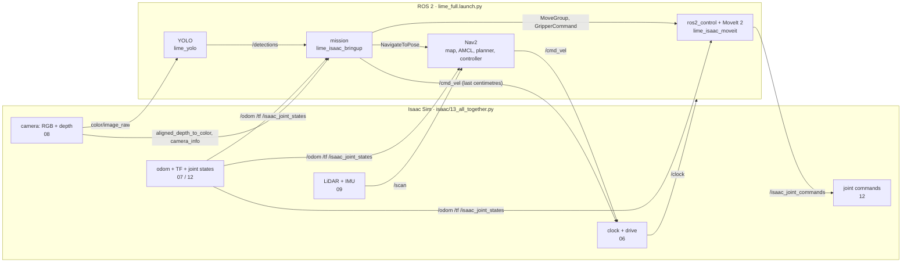
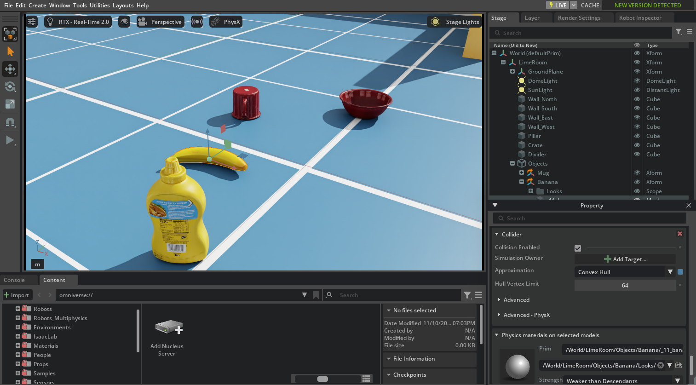
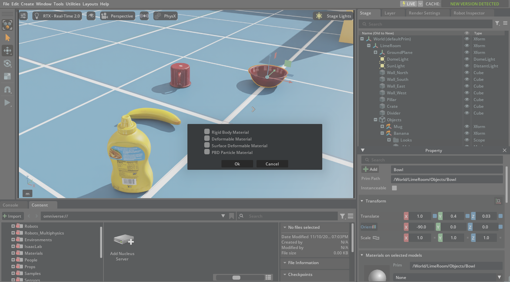
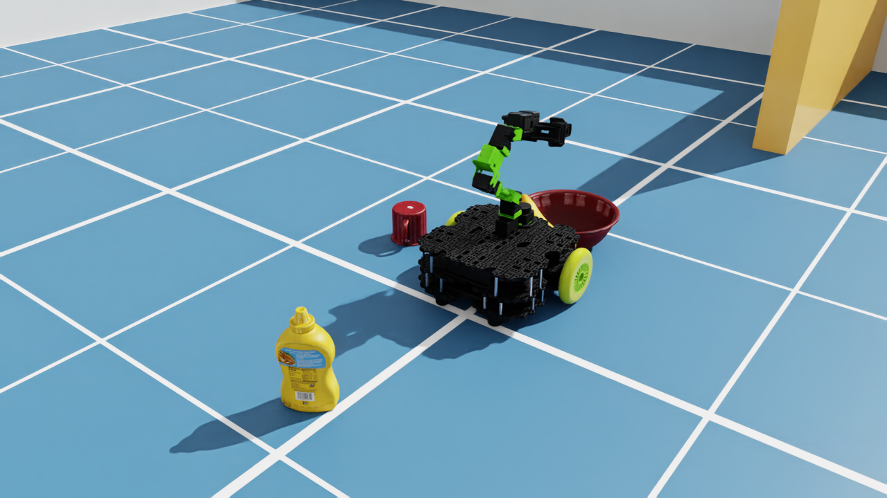
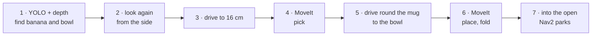
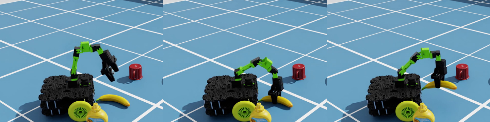

# 13 · Putting it all together: pick and place

<p class="tutorial-meta">⏱ 45 min · Level: intermediate · Script: <code>isaac/13_all_together.py</code> · ROS: <code>lime_full.launch.py</code>, <code>mission</code></p>

**Goal.** Run the complete simulated TurtleBot3 Lime, with every sensor and graph from tutorials 06–12 plus MoveIt 2,
Nav2 and YOLO at the same time. Then give it a job: **find the banana, pick it up, put it into the bowl, and
park**. You'll see how the pieces connect: a 2D detection becomes a 3D position, the robot drives up to it
precisely, and the arm grasps it.

<figure class="result" markdown>
<video controls autoplay loop muted playsinline>
  <source src="../../assets/video/tutorial13_all_together.mp4" type="video/mp4">
</video>
<figcaption>The mission: YOLO and the depth camera find the banana, the Lime drives up to it, MoveIt picks it up, the robot carries it to the bowl and drops it in, then Nav2 parks the robot in the far corner.</figcaption>
</figure>

## The whole system



!!! info "One robot_state_publisher"
    `lime_full.launch.py` includes `lime_isaac_moveit/moveit.launch.py`, which brings the one and only
    `robot_state_publisher`. Its URDF also contains the ros2_control block. Nav2's bringup is included directly,
    without `navigation.launch.py`, so a second `robot_state_publisher` never starts. `/joint_states` comes only from
    `joint_state_broadcaster` (see [tutorial 12](12-moveit2.md)).

## Objects you can pick up

In tutorials 08–10 the objects on the floor are only pictures for the camera: they have no collider and no mass.
Since [tutorial 11](11-nav2.md) they are real (`add_object_physics`): colliders and mass, so the robot cannot drive
through them, and they would be knocked over if it drove into them. Picking one up needs two more things: a bowl
the banana fits into, and grippy fingers.

| Object | Physics | Why |
|---|---|---|
| banana | rigid body, 66 g, *convex decomposition* collider | it must fall, be pushed and be lifted. A single convex hull would turn the curved banana into a blob 7 cm wide, too wide for the gripper |
| mug, mustard bottle | rigid bodies, 118 g and 603 g; *convex decomposition* for the mug, *convex hull* for the bottle | they would be knocked over if the robot drove into them. With the default convex hull the mug crept 16 cm across the floor by itself in 5 s; with a convex decomposition it stands still |
| bowl | static collider, *none* (the exact triangle mesh), and in this tutorial **1.5× bigger** | it must hold the banana in its hollow; the 19 cm banana does not fit in the original 16 cm bowl |
| fingers + banana | physics material, friction 1.0 (this tutorial) | rubber-like pads, so a 10 N squeeze holds the banana |

=== "GUI"

    Open `assets/scenes/lime_room.usda`, then use the Property panel's **+ Add** button:

    1. Select `/World/LimeRoom/Objects/Banana`. Choose **+ Add ▸ Physics ▸ Rigid Body with Colliders Preset**, then
       **+ Add ▸ Physics ▸ Mass**, and set *Mass* to 0.066. Do the same for the `Mug` (0.118) and the `Bottle`
       (0.603). The bottle can keep its *Convex Hull*; give the mug's mesh **Convex Decomposition** too (step 2).
    2. Expand the banana in the Stage panel and select its mesh. The preset gave it a **Convex Hull** collider.
       Change *Approximation* to **Convex Decomposition**.

        { .full }

    3. Select the bowl. Set *Scale* to 1.5 and *Translate Z* to 0.044, so it still stands on the floor. Then choose
       **+ Add ▸ Physics ▸ Colliders Preset**: a static collider with approximation *None* (the triangle mesh
       itself), which is allowed for an object that never moves.
    4. **Create ▸ Physics ▸ Physics Material**, tick **Rigid Body Material** and click **Ok**. Set its static and
       dynamic friction to 1.0. Select the banana's mesh again and pick the new material in its **Physics materials
       on selected models** section (this section appears on collider prims only).

       The fingers need the same material, but the robot's finger colliders (`gripper_left_palm`,
       `gripper_right_palm`) are *instanced*: shared, read-only copies that the GUI cannot change. The Python
       version binds the material one level up, on `gripper_left_link` and `gripper_right_link`, and the binding
       applies to every collider below them.

        { .full }

    Press **Play** and drag the banana with **Shift + left mouse**: it now falls and tumbles.

=== "Python (standalone)"

    `13_all_together.py` builds the same scene as tutorial 11, with `object_physics=True`:

    ??? example "`add_object_physics()`: colliders and mass for every object (tutorials 11 and 13)"
        ```python
        --8<-- "isaac/common/scene.py:add_object_physics"
        ```

    and then calls one extra function for the bowl and the fingers:

    ```python
    --8<-- "isaac/common/scene.py:setup_pick_and_place"
    ```

## Run it

Terminal 1, Isaac Sim:

```bash
source scripts/isaac_env.sh
python isaac/13_all_together.py
```

Terminal 2, the ROS 2 stack (wait for *"Managed nodes are active"* and *"You can start planning now!"*):

```bash
./scripts/build_ws.sh
./docker/run_ros.sh ros2 launch lime_isaac_bringup lime_full.launch.py
```

Terminal 3, the mission (the first start downloads `yolo11m.pt`, about 40 MB, in terminal 2):

```bash
./docker/run_ros.sh ros2 run lime_isaac_bringup mission
```

```text
YOLO: banana (0.87) at (0.75, -0.11), bowl (0.70) at (0.96, 0.41)
YOLO: banana (0.92) at (0.792, -0.123), pointing 19 deg
MoveIt: above the banana: done
MoveIt: down to the banana: done
MoveIt: lift: done
MoveIt: carry: done
YOLO: bowl (0.74) at (0.998, 0.377), radius 9 cm
MoveIt: above the bowl: done
MoveIt: arm folded: done
Nav2: parking at (2.8, -1.8)
mission complete: the banana is in the bowl
```

In the simulation the banana really is at (0.800, −0.121), pointing 20°, and the bowl at (1.0, 0.4). The first
look, from the start, is 5 cm short. The second look, from the side, is within 1 cm, which is good enough to
grasp.

{ .full }

## How the mission works



??? example "The mission's main part: `lime_isaac_bringup/scripts/mission.py`"
    ```python
    --8<-- "ros2_ws/src/lime_isaac_bringup/scripts/mission.py:mission"
    ```

### 1. From a 2D box to 3D points

!!! note "A bigger YOLO"
    `lime_full.launch.py` runs **`yolo11m.pt`** (medium) instead of tutorial 10's `yolo11n.pt` (nano). Seen from
    the low camera, the banana is a flat yellow crescent: the nano model calls it a *frisbee* (0.44), the small one
    a banana with 0.46, the medium one a banana with 0.88. (In tutorial 10 the nano model just finds the banana,
    with 0.40. Here the banana has physics and rests a few millimetres differently, and the nano model's answer
    tips over to *frisbee*.) The medium model takes about 75 ms per image on the CPU, which is fine at 5 images per
    second. Choose it with `yolo_model:=...`.

YOLO says *"banana, 0.9, in this box"*: pixels, not metres. The aligned depth image (tutorial 08) has, for every
pixel $(u, v)$, the distance $z$ along the camera's axis. The camera model from `camera_info` turns that into a
3D point in the camera's optical frame:

$$
x = \frac{(u - c_x)\,z}{f_x}, \qquad y = \frac{(v - c_y)\,z}{f_y}, \qquad z = z
$$

TF then moves the points from `camera_color_optical_frame` into the `odom` frame, **using the transform from the
moment the image was taken** (the detection's time stamp). The robot may have moved since then. Points on the floor
($z \approx 0$) are dropped. What is left is a small point cloud of the object.

??? example "`Lime.locate()`"
    ```python
    --8<-- "ros2_ws/src/lime_isaac_bringup/scripts/mission.py:locate"
    ```

### 2. Where exactly is it?

The camera sees only the front of an object, so each shape gets its own small rule:

- **Banana (a long object):** its direction is the main axis of its points (principal component analysis), and
  the gripper closes *across* it. The grasp point is the **middle of its length**, halfway between the two ends.
  It is not simply the average point: the end nearer the camera gets more depth pixels and pulls the average
  towards it.
- **Bowl (a round object):** the centre is not in the middle of the visible points, because those are all on the
  front. It lies one radius further along the line of sight, and the radius is half the visible width.

??? example "`long_object()` and `round_object()`"
    ```python
    --8<-- "ros2_ws/src/lime_isaac_bringup/scripts/mission.py:shapes"
    ```

### 3. The last centimetres: drive with odometry

Looking straight down, the arm reaches the floor only between about 12 and 20 cm in front of `base_footprint`.
Nav2 stops within its goal tolerance of 25 cm, which is fine for parking but far too coarse for grasping. So for
the short moves the mission drives itself: turn towards the target, drive in a straight line, and stop within a
centimetre. It publishes `/cmd_vel` and reads the pose from TF (`odom → base_footprint`, Isaac Sim's odometry).
Speed changes are gentle, because the robot may be carrying a banana.

Two rules keep this simple:

- **Look from the side, then drive blind.** From the start the camera sees the banana almost end-on, and its far
  half hides behind its near half (the estimate was 5 cm short). So the robot looks again from 45 cm away and
  55° further round. Then it drives the last 30 cm blind: close up, the low camera no longer sees the banana properly (at
  16 cm the image's lower edge cuts it off), and Isaac Sim's odometry was within 3 mm of the truth after a 0.8 m
  drive in tutorial 07.
- **Go round the objects yourself.** These short drives don't use Nav2, so nothing plans round the mug: the
  mission approaches the bowl from its open side.
- **Hand over to Nav2 in the open.** After the drop the robot stands right next to the mustard bottle. Nav2 does
  see the bottle, but started that close to it, the first version of this mission drove straight through it. So
  the mission backs away from the bowl and drives 60 cm into the open middle of the room before Nav2 takes over.

??? example "`turn_to()`, `drive_to()`, `to_base()`"
    ```python
    --8<-- "ros2_ws/src/lime_isaac_bringup/scripts/mission.py:base"
    ```

### 4. A top-down grasp: inverse kinematics on paper

For a grasp from straight above, the Lime's 6-joint arm becomes simple:

- `joint1` turns towards the object;
- `joint2` (shoulder) and `joint3` (elbow) form a **planar two-link arm** with lengths $L_1 = 12.4$ cm and
  $L_2 = 10.45$ cm, which puts the wrist $L_3 = 16.25$ cm above `end_effector_link` (the fingertips reach 2 cm
  lower still);
- `joint5` makes the three tilts add up to 180°, so the gripper points down;
- `joint6` turns the fingers across the banana.

With $r$ = the horizontal distance and $d_z$ = the height of the wrist above the shoulder, the law of cosines
gives the elbow:

$$
\cos\theta_3 = \frac{r^2 + d_z^2 - L_1^2 - L_2^2}{2 L_1 L_2}, \qquad
\theta_2 = \operatorname{atan2}(r, d_z) - \operatorname{atan2}(L_2 \sin\theta_3,\; L_1 + L_2 \cos\theta_3), \qquad
\theta_5 = \pi - \theta_2 - \theta_3
$$

The mission computes these joint angles and gives them to **MoveIt as joint goals**. MoveIt still does the
planning: a collision-free, smooth trajectory that respects the joint limits (the mission adds the floor to
MoveIt's planning scene first). The grasp puts `end_effector_link` 10 cm above the floor, then down to 3 cm (the
fingertips are then about 1 cm above the floor), closes the gripper, and lifts to 15 cm.

{ .full }

*Above the banana, down and close, lift. Two fingers pinching a curved banana act like a hinge, so the banana can
swing as the arm moves (watch the video). It is still held firmly.*

??? example "`top_down_ik()`"
    ```python
    --8<-- "ros2_ws/src/lime_isaac_bringup/scripts/mission.py:ik"
    ```

!!! note "Why not a pose goal?"
    MoveIt can solve inverse kinematics itself (`kinematics.yaml`, KDL). The Lime's MoveIt config uses
    `position_only_ik: True`, which ignores the gripper's orientation, so a "point straight down" pose goal would
    not be kept. For a top-down grasp the closed-form solution above is exact, instant, and easy to check.

### 5. Holding on

The gripper is told to close fully (−1 cm) and stops when the fingers touch the banana. The
`GripperActionController` keeps commanding the closed position, so the position drive (tutorial 03: stiffness
1000 N/m, at most 10 N) keeps squeezing while the arm lifts and the robot drives.

The controller would finish the goal once it detects a *stall*: a finger velocity of almost zero for 2 s
(`allow_stalling: true` in tutorial 12's `ros2_controllers.yaml`). In the simulation, though, a finger pressing
against an object reports a velocity (about 0.3 m/s here) although its position does not change,
so the stall is never detected. The mission therefore waits at most 3 s for the gripper and then carries on. The
goal stays active, and the next gripper command (open, above the bowl) replaces it.

## Automatic check

`python isaac/13_all_together.py --headless --test` follows the mission using the simulation's ground truth:

```text
[13] ground truth: banana at [ 0.8   -0.121], bowl at [1.  0.4]
[13] banana lifted (10 cm above the floor) at t = 45 s
[13] banana in the bowl, 3.7 cm from its centre at t = 69 s
[13] arm folded at t = 71 s
[13] robot parked in the far corner at t = 95 s
[13][check] ok   banana picked up (more than 10 cm above the floor)
[13][check] ok   banana put into the bowl (within 7 cm of its centre)
[13][check] ok   arm folded afterwards
[13][check] ok   robot parked in the far corner (within 0.3 m)
[13][check] ok   banana still in the bowl at the end (3.7 cm from its centre)
[13][check] ok   mug not bumped into (moved 0.0 cm)
[13][check] ok   bottle not bumped into (moved 0.0 cm)
[13][test] PASS
```

The banana lands about 4 cm from the bowl's centre, short of it, because the stretched-out arm reaches only
18 cm in front of the robot at that height (joint5's limit). The bowl's radius is 12 cm.

## Things that went wrong while building this (and the fixes)

| Symptom | Cause | Fix |
|---|---|---|
| The grasp missed by 2 cm, and the robot had turned 6° | the arm's target jumped in one step, and the jolt turned the robot | always move the arm smoothly (MoveIt trajectories do that) |
| The banana slipped out when lifted | default friction 0.5, and the banana was grasped off-centre | rubber-like friction 1.0, grasp at the middle of its points |
| The fingers could not close around the banana | `convexHull` made the curved banana a 7 cm blob | `convexDecomposition` |
| The banana lay on the bowl's rim | 19 cm banana, 16 cm bowl | a 1.5× bowl, and release the banana across the robot |
| YOLO: *frisbee* instead of banana | a flat crescent seen from 5.8 cm above the floor | the medium model `yolo11m.pt` |
| The banana estimate was 5 cm short | seen end-on, its far half hides behind its near half | look again from the side; use the middle of its length |
| The mission hung after closing the gripper | the squeezing finger reports a velocity, so the controller never detects the stall | wait at most 3 s for the gripper |
| The mug crept across the floor by itself | its convex-hull collider (the mug's mesh has a flat base, so the hull is the culprit, not the model) | `convexDecomposition` for the mug |
| The robot drove through the mustard bottle on its way to park | the bottle had no collider, and Nav2 started right next to it | colliders for the mug and the bottle, and drive into the open before Nav2 takes over |
| MoveIt: `Start state out of bounds … joint3` after driving | the folded pose (`joint3` = 1.85) sagged onto the joint limit (1.8567) | fold to `joint3` = 1.80 (tutorial 03's start pose and the SRDF) |

## Where to go from here

- **Other objects.** `locate()` works for any of YOLO's 80 classes. Give the object physics like the banana, and
  pick a grasp rule for its shape.
- **Grasp from the side.** A tall object such as the bottle needs a horizontal gripper: change the condition
  $\theta_2 + \theta_3 + \theta_5 = \pi$ to $\pi/2$, and put the wrist $L_3$ in front of the grasp point instead
  of above it.
- **Train your own detector.** Isaac Sim's Replicator can render thousands of labelled images of the lime_room.
- **The real robot.** The ROS side uses the real Lime's topic and frame names, so moving to hardware is mostly a
  matter of swapping the simulation for the real drivers (the `JointStateTopicSystem` for the Lime's own ros2_control
  hardware, the RealSense and LDS drivers). This was not tested on a real Lime.

??? example "The launch file: `lime_isaac_bringup/launch/lime_full.launch.py`"
    ```python
    --8<-- "ros2_ws/src/lime_isaac_bringup/launch/lime_full.launch.py"
    ```

??? example "Isaac Sim side: `isaac/13_all_together.py`"
    ```python
    --8<-- "isaac/13_all_together.py"
    ```

??? example "The whole mission: `lime_isaac_bringup/scripts/mission.py`"
    ```python
    --8<-- "ros2_ws/src/lime_isaac_bringup/scripts/mission.py"
    ```

Happy simulating! 🍋
