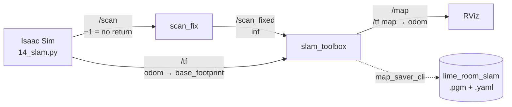
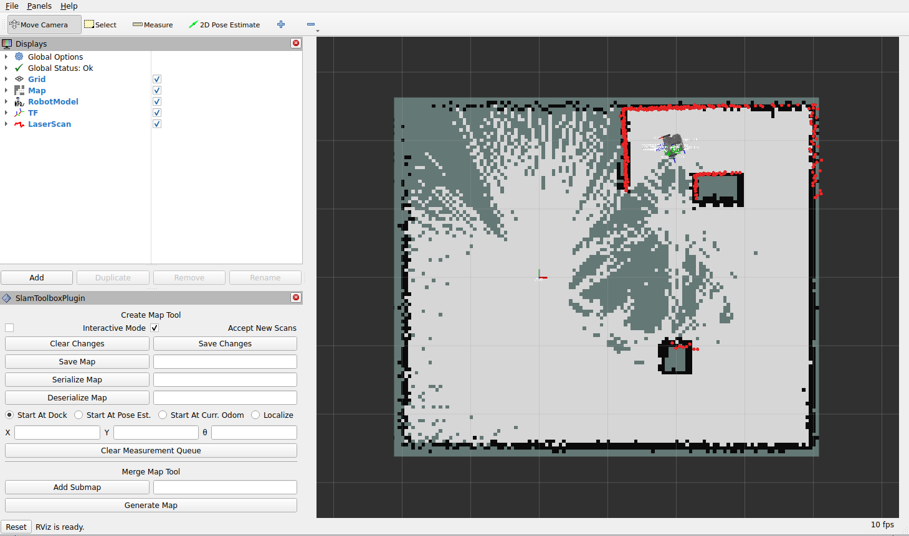
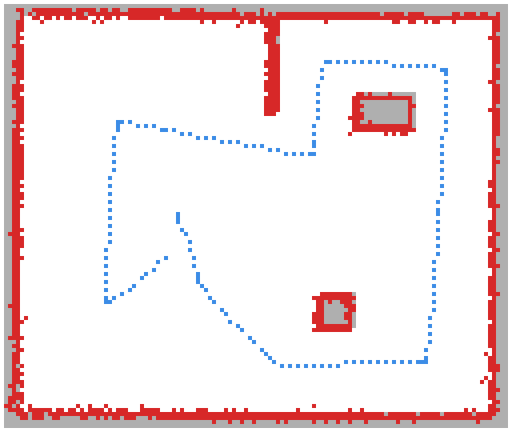

# 14 · Make your own map with SLAM

<p class="tutorial-meta">⏱ 30 min · Level: intermediate · Script: <code>isaac/14_slam.py</code> · ROS: <code>lime_isaac_bringup/slam.launch.py</code>, <code>scan_fix</code></p>

**Goal.** In tutorial 11, Isaac Sim computed the map straight from the scene. A real robot can't do that. It has
to drive around and build the map from its own LiDAR while working out where it is: **SLAM**, *simultaneous
localisation and mapping*. Here you map the lime_room with **slam_toolbox**, the SLAM package that Nav2 uses,
save the map, compare it with Isaac Sim's map, and navigate on it.

<figure class="result" markdown>
<video controls autoplay loop muted playsinline>
  <source src="../../assets/video/tutorial14_slam.mp4" type="video/mp4">
</video>
<figcaption>Left: the Lime drives a tour of the lime_room. Right: slam_toolbox's map (<code>/map</code>) growing as it drives, with the robot's true position (green).</figcaption>
</figure>

## Concepts

The wheel odometry tells the robot how far it has driven, but on a real robot it drifts: wheels slip, and every
small error adds up. slam_toolbox corrects it with the LiDAR:

- **Scan matching.** Each new scan is lined up with the scans before it. Where it fits best is where the robot
  really is.
- **Loop closure.** When the robot comes back to a place it has seen before, slam_toolbox recognises it and
  corrects the whole path in between.

It publishes the map, `/map`, and the TF `map → odom`: the correction between where odometry thinks the robot is
and where it really is. That is the same job AMCL does in tutorial 11, but without a map to start from:

| | Tutorial 11 (Nav2) | Tutorial 14 (SLAM) |
|---|---|---|
| The map | Isaac Sim computes it from the colliders | slam_toolbox builds it from `/scan` while you drive |
| `map → odom` | AMCL (localises in a known map) | slam_toolbox |
| Isaac Sim side | `/clock`, `/cmd_vel`, `/odom`, `/tf`, `/joint_states`, `/scan` | the same: nothing new |



You drive with `teleop_twist_keyboard` (`/cmd_vel`), or let the script drive.

!!! warning "Isaac Sim's LiDAR writes −1 for “nothing there”, and slam_toolbox can't handle it"
    When a beam hits nothing within 3.5 m, Isaac Sim's RTX LiDAR reports a range of **−1.0** (tutorial 09).
    ROS's convention ([REP 117](https://ros.org/reps/rep-0117.html)) is **+inf**. Tutorial 11's AMCL and
    costmaps work fine with the −1, but slam_toolbox's scan matcher ignores only `inf` and `NaN`. It turns every
    −1 into a point **1 m away, on the opposite side of its own beam**. On the tour that is 30 to 150 of the
    360 beams, typically 85: phantom points in every scan. They move with the robot and drag the scan matcher
    back.

    The fix is a tiny node, `scan_fix`, that republishes `/scan` as `/scan_fixed` with every −1 replaced by
    `inf`. `slam.launch.py` starts it, and slam_toolbox reads `/scan_fixed`.

    How much the −1 hurts depends on how often slam_toolbox adds a scan to its map (`minimum_travel_distance`,
    `minimum_travel_heading`). The same recorded tour, replayed into slam_toolbox, gives these largest pose
    errors during the tour (and at the end):

    | slam_toolbox adds a scan every | `/scan` with −1 | `/scan_fixed` with inf |
    |---|---|---|
    | 0.2 m or 0.3 rad | **137 cm** (136 cm, 25°): the map twists | 13 cm (8.5 cm, 1.2°) |
    | 0.5 m or 0.5 rad (default, used here) | 11 cm (11 cm, 2.0°) | **7 cm (2.4 cm, 1.0°)** |

    ```python
    --8<-- "ros2_ws/src/lime_isaac_bringup/scripts/scan_fix.py:scan_fix"
    ```

## Part 1: start the simulation

!!! note "Clear the floor before you map"
    A map is for things that stay put: the walls, the pillar, the crate, the divider. SLAM can't tell those from
    a mustard bottle. It maps everything its LiDAR sees, and the LiDAR scans 16 cm above the floor: the bottle is
    19 cm tall, so it would go into the map like a small pillar. Move the bottle later, and Nav2 still plans
    round the spot where it was, while AMCL compares the scans with a map that no longer fits.

    So tidy up first, as you would before mapping a real room: in this tutorial the four objects are not on the
    floor. Things that come and go are the costmaps' job. Nav2 sees them with the live LiDAR (part 5).

=== "GUI"

    Isaac Sim needs nothing new, but all the pieces have to be in one stage:

    1. Start from your stage of tutorial 09: the lime_room, the robot, and the LiDAR graph (`/scan`).
    2. Clear the floor: in the **Stage** panel, select `/World/LimeRoom/Objects` and press **Delete**. (If you
       save, save under a new name, so that tutorial 09 keeps its objects.)
    3. Add the graphs you built in tutorial 06 (`/clock`, `/cmd_vel`) and tutorial 07 (`/odom`, `/tf`,
       `/joint_states`), the same way as there.
    4. Press **Play**.

    That's a lot of clicking. The Python script builds the same stage with four function calls (other tab).

=== "Python (standalone)"

    ```bash
    source scripts/isaac_env.sh
    python isaac/14_slam.py                # you drive
    python isaac/14_slam.py --auto-drive   # the script drives a tour of the room for you
    ```

    The script builds the same robot and graphs as tutorial 11, in the lime_room without the objects
    (`build_lime_room(stage, with_objects=False)`):

    ```python
    graphs.create_clock_graph()                                     # 06  /clock
    graphs.create_drive_graph(articulation_root)                    # 06  /cmd_vel
    graphs.create_odom_tf_joint_states_graph(articulation_root)     # 07  /odom /tf /joint_states
    graphs.create_lidar_graph(sensors.add_lds_lidar(robot_path))    # 09  /scan
    ```

    With `--auto-drive` it follows a fixed tour that passes every obstacle on both sides. The driver uses the
    true position from the simulation, but slam_toolbox never sees it:

    ```python
    --8<-- "isaac/14_slam.py:route"
    ```

    ??? example "Full script: `isaac/14_slam.py`"
        ```python
        --8<-- "isaac/14_slam.py"
        ```

## Part 2: map the room

Terminal 2, slam_toolbox + RViz:

```bash
./scripts/build_ws.sh lime_isaac_bringup     # (again) - installs the new scan_fix node
./docker/run_ros.sh ros2 launch lime_isaac_bringup slam.launch.py
```

Terminal 3, drive (skip this with `--auto-drive`):

```bash
./docker/run_ros.sh ros2 run teleop_twist_keyboard teleop_twist_keyboard
```

The map appears in RViz around the robot and grows as you drive.

{ .full }

*RViz (`slam.rviz`) part-way through the tour, with the robot at the top, between the divider and the crate: the map so far (light
grey = free, black = walls, dark grey = not seen yet), the LiDAR scan (red dots), and slam_toolbox's own panel at
the bottom left.*

!!! tip "How to drive for a good map"
    - **Slowly, especially when turning.** One LiDAR turn takes 0.2 s, and the robot shouldn't move much in
      that time. The tour uses 0.2 m/s and 0.2 rad/s.
    - **See every wall from close by.** The LDS-01 reaches only 3.5 m.
    - **Come back to where you started.** That closes the loop, and slam_toolbox straightens the whole map.

## Part 3: save the map

While slam_toolbox is still running:

```bash
./docker/run_ros.sh bash -c 'mkdir -p /lime/my_maps && ros2 run nav2_map_server map_saver_cli -f /lime/my_maps/lime_room_slam --ros-args -p use_sim_time:=true'
```

This writes `my_maps/lime_room_slam.pgm` and `.yaml` in the repository. It's the same format as tutorial 11's
map, so Nav2 can use it.

## Part 4: compare with Isaac Sim's map

In simulation you know the truth, so you can grade the SLAM map. Grey is Isaac Sim's map from tutorial 11 without
the four objects (they weren't on the floor), red is what slam_toolbox found, and blue is the robot's path:

{ width="520" }

*99.7 % of the SLAM wall cells lie on a real wall (within 10 cm), and SLAM found every wall face that the LiDAR can
see from inside the room. The walls, the pillar, the crate and the divider are all there.*

!!! info "A SLAM map contains exactly what the LiDAR sees"
    The LiDAR scans one plane, 16 cm above the floor. SLAM maps everything that crosses it, and nothing below it.
    With the objects left on the floor, the bottle (19 cm) would be in the map like a small pillar, and the banana
    (4 cm), the mug (8 cm) and the bowl (6 cm) would not be there at all. Tutorial 11's map is different on
    purpose: Isaac Sim draws all four objects into it from a 1–50 cm height band, because Nav2 can't avoid the
    low ones otherwise. That is a simulation shortcut. On a real robot you would add a depth camera to the
    costmaps, or draw the low obstacles in yourself as keep-out zones.

## Part 5: navigate on your map

Tutorial 11, with your map instead of Isaac Sim's:

```bash
python isaac/11_nav2.py                                                                      # terminal 1
./docker/run_ros.sh ros2 launch lime_isaac_bringup navigation.launch.py map:=/lime/my_maps/lime_room_slam.yaml   # terminal 2
```

Nav2 localises with AMCL on your map just as well. `11_nav2.py` puts the four objects back on the floor, and
none of them is in your map:

- **The bottle** is no problem. The LiDAR sees it, and the costmaps' obstacle layers mark it from the live scan,
  just as they would mark a person walking by.
- **The banana, the mug and the bowl** are lower than the LiDAR's plane. Neither your map nor the LiDAR knows
  they are there.

The check `14nav` sends tutorial 11's goal (3.2, −1.8) on the map that the SLAM check has just saved: the robot
gets there in 27 s (3.99 m) without touching anything, 44 cm from the bottle. Its path happens to pass the banana
at 38 cm, as on Isaac Sim's map, but a goal right behind the banana would send the robot into it.

### The Lime's slam_toolbox parameters

`lime_isaac_bringup/config/slam_params.yaml` is **slam_toolbox's own** `mapper_params_online_async.yaml`, with only
these changes:

| Parameter | Value | Why |
|---|---|---|
| `scan_topic` | `/scan_fixed` | the scan with `inf` instead of −1 (see above) |
| `min_laser_range` / `max_laser_range` | 0.12 / 3.5 m | LDS-01 |
| `map_update_interval` | 1 s (default 5 s) | watch the map grow |

!!! note "Keep slam_toolbox's default keyframe spacing"
    slam_toolbox adds a scan to its map every 0.5 m or 0.5 rad. For a small room, more scans sound better, but
    every scan it matches is another chance to be slightly wrong: with 0.2 m / 0.3 rad the recorded tour ended
    8.5 cm off even with `/scan_fixed`, and with the defaults 2.4 cm (table above).

## Automatic check

`python isaac/14_slam.py --headless --test` drives the tour and then grades slam_toolbox's map against Isaac Sim's
map, and its robot pose against the true one. `tools/run_all_checks.sh 14` starts slam_toolbox and saves the map:

```text
[14] waypoint 1/10 (0.3, -0.9): SLAM pose error 1.4 cm, 0.2 deg
[14] waypoint 2/10 (1.3, -1.9): SLAM pose error 3.1 cm, 0.2 deg
[14] waypoint 3/10 (3.2, -1.8): SLAM pose error 5.1 cm, 0.2 deg
...
[14] waypoint 5/10 (3.4, 1.9): SLAM pose error 6.2 cm, 0.8 deg
...
[14] waypoint 10/10 (0.0, -0.4): SLAM pose error 3.2 cm, 1.4 deg
[14] route done at t = 134 s: save the map now
[14] /map: 124 x 105 cells, 1188 occupied; 200 map updates
[14][check] ok   slam_toolbox published /map
[14][check] ok   the tour was driven to the end
[14][check] ok   SLAM walls lie on real walls (+-10 cm): 99.7%
[14][check] ok   real walls found by SLAM (+-10 cm): 100.0%
[14][check] ok   Pillar at (2.0, -1.2) is in the SLAM map (67 cells)
[14][check] ok   Crate at (2.6, 1.3) is in the SLAM map (79 cells)
[14][check] ok   Divider at (1.2, 1.9) is in the SLAM map (97 cells)
[14][check] ok   SLAM's robot pose at the end vs ground truth: 3.1 cm, 1.4 deg
[14][check] ok   largest SLAM pose error at the waypoints: 6.2 cm, 1.6 deg
[14][test] PASS
```

Both percentages leave out the four objects (they are in Isaac Sim's map, but not in this room) and the outer side
of the room's walls, which the LiDAR can't see from inside. A map cell is 5 cm,
so the pose may be off by a cell or two. Without `scan_fix` and with scans every 0.2 m / 0.3 rad, the same tour drifted by more than 1 m.

## Troubleshooting

| Symptom | Fix |
|---|---|
| The map twists and walls appear twice | Is slam_toolbox reading `/scan_fixed` (`scan_fix` running)? Raw Isaac Sim scans contain −1. Keep the default `minimum_travel_*`, and drive and turn slowly. |
| RViz: *"Frame [map] does not exist"* | slam_toolbox publishes `map` after its first scan: is `/scan` arriving, and is the simulation playing? |
| `map_saver_cli` times out | It needs a running slam_toolbox, and sim time (`use_sim_time:=true`). |
| Something you moved away is still in the map | It was there when you mapped. Clear the floor and map again, or paint the spot white (free) in the `.pgm` with an image editor. |
| Nav2 drives over the banana on your SLAM map | The LiDAR can't see it (part 4). Use Isaac Sim's map, or draw the object into your map. |
| The map is wrong after you restart Isaac Sim | Restart slam_toolbox too: simulation time went back to 0. |

**Back to:** [Home](../index.md)
