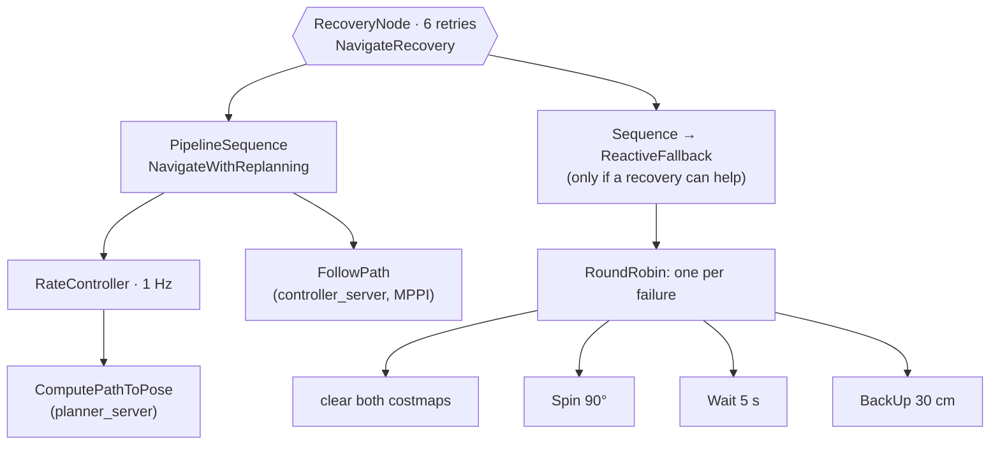
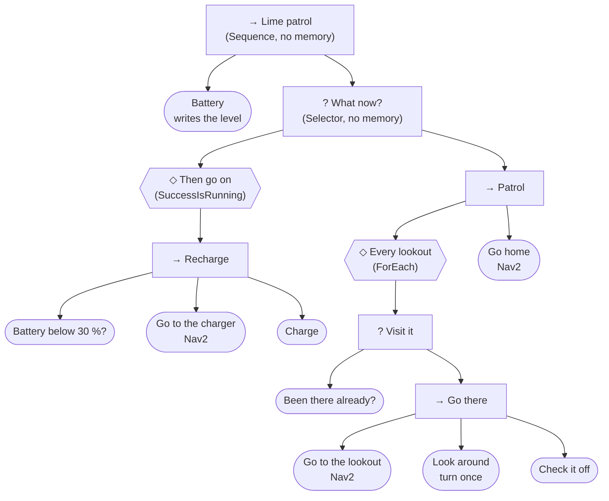

# 15 · Behavior trees

<p class="tutorial-meta">⏱ 40 min · Level: intermediate · Script: <code>isaac/15_behavior_tree.py</code> · ROS: <code>navigation.launch.py</code>, <code>patrol</code></p>

**Goal.** Learn **behavior trees**, the way Nav2 and many robots organise their decisions. First read the tree
that runs inside Nav2 and watch it work. Then write your own tree with **py_trees**: a patrol of the lime_room
that is interrupted when the (pretend) battery runs low, and carries on after charging. Tutorial 16 uses the
same building blocks for a much longer job.

<figure class="result" markdown>
<video controls autoplay loop muted playsinline>
  <source src="../../assets/video/tutorial15_patrol.mp4" type="video/mp4">
</video>
<figcaption>The patrol: lookouts 1–3, where the robot looks around at each. On the way to lookout 4, the battery drops below 30 %: the tree interrupts the patrol, the robot charges in the west, finishes the patrol and comes home. It never touches the traffic cone.</figcaption>
</figure>

## Why a tree?

Tutorial 13's mission is a script: step 1, step 2, step 3, and if anything fails, stop. That is fine for one
banana. A longer job needs more:

- **try again** when something fails (the grasp missed);
- **try something else** (that lookout can't be reached: skip it);
- **interrupt** what you are doing for something more important (the battery is low), and **carry on**
  afterwards.

Written with `if`s and flags, this becomes hard to read quickly. A behavior tree gives each of these patterns a
name, and the mission becomes a tree of small, reusable pieces.

## Concepts

The tree is **ticked**, about 10 times a second. A tick starts at the root and goes down to the behaviours that
have work to do. Every behaviour that is ticked answers with one of three words:

| Status | Meaning |
|---|---|
| **SUCCESS** | done, it worked |
| **FAILURE** | done, it didn't work |
| **RUNNING** | not done yet: tick me again |

The leaves do the work (*drive to the charger*) or check something (*is the battery low?*). The nodes above
them decide which leaf to tick:

| Node | Symbol | What it does |
|---|---|---|
| **Sequence** | → | ticks its children in order; fails as soon as one fails. *"Do this, then that."* |
| **Selector** (Nav2: **Fallback**) | ? | ticks its children in order; succeeds as soon as one succeeds. *"Try this, else that."* |
| **Decorator** | ◇ | changes what its one child says: *Retry* (try again after a failure), *Repeat*, *Inverter* (swap SUCCESS and FAILURE), *ForEach* (once per item of a list), ... |

The children's order is their **priority**. With *memory*, a Sequence or Selector continues with the child that
was RUNNING at the last tick. Without memory, it starts again from its first child on every tick: a
higher-priority child that now succeeds (*the battery is low*) can **interrupt** a lower one that was running
(*drive to the lookout*). That is how a tree reacts.

Behaviours share data through the **blackboard**, a dictionary that every behaviour can read and write: the
battery level, the next lookout, the thing to pick up.

## Part 1: the tree inside Nav2

You have used a behavior tree since tutorial 11: Nav2's **bt_navigator** runs one for every goal. It is written in
XML for **BehaviorTree.CPP**, and Jazzy ships several. The default one for `NavigateToPose` is
`navigate_to_pose_w_replanning_and_recovery.xml`:



- **PipelineSequence** ticks the planner and the controller *together*: `FollowPath` keeps the robot moving
  along the current path while the **RateController** lets `ComputePathToPose` plan a new one once a second.
  That is why Nav2 steers round the traffic cone of tutorial 11 as soon as the LiDAR sees it.
- **RecoveryNode** is a decorator-like node with two children: if the first fails, it ticks the second (a
  recovery) and then tries the first again, up to 6 times.
- **RoundRobin** picks the *next* recovery each time: first clear the costmaps, then spin, then wait, then back
  up.

??? example "The XML: `nav2_bt_navigator/behavior_trees/navigate_to_pose_w_replanning_and_recovery.xml`"
    ```xml
    <!--
      This Behavior Tree replans the global path periodically at 1 Hz and it also has
      recovery actions specific to planning / control as well as general system issues.
      This will be continuous if a kinematically valid planner is selected.
    -->
    <root BTCPP_format="4" main_tree_to_execute="MainTree">
      <BehaviorTree ID="MainTree">
        <RecoveryNode number_of_retries="6" name="NavigateRecovery">
          <PipelineSequence name="NavigateWithReplanning">
            <ControllerSelector selected_controller="{selected_controller}" default_controller="FollowPath" topic_name="controller_selector"/>
            <PlannerSelector selected_planner="{selected_planner}" default_planner="GridBased" topic_name="planner_selector"/>
            <RateController hz="1.0">
              <RecoveryNode number_of_retries="1" name="ComputePathToPose">
                <ComputePathToPose goal="{goal}" path="{path}" planner_id="{selected_planner}" error_code_id="{compute_path_error_code}"/>
                <Sequence>
                  <WouldAPlannerRecoveryHelp error_code="{compute_path_error_code}"/>
                  <ClearEntireCostmap name="ClearGlobalCostmap-Context" service_name="global_costmap/clear_entirely_global_costmap"/>
                </Sequence>
              </RecoveryNode>
            </RateController>
            <RecoveryNode number_of_retries="1" name="FollowPath">
              <FollowPath path="{path}" controller_id="{selected_controller}" error_code_id="{follow_path_error_code}"/>
              <Sequence>
                <WouldAControllerRecoveryHelp error_code="{follow_path_error_code}"/>
                <ClearEntireCostmap name="ClearLocalCostmap-Context" service_name="local_costmap/clear_entirely_local_costmap"/>
              </Sequence>
            </RecoveryNode>
          </PipelineSequence>
          <Sequence>
            <Fallback>
              <WouldAControllerRecoveryHelp error_code="{follow_path_error_code}"/>
              <WouldAPlannerRecoveryHelp error_code="{compute_path_error_code}"/>
            </Fallback>
            <ReactiveFallback name="RecoveryFallback">
              <GoalUpdated/>
              <RoundRobin name="RecoveryActions">
                <Sequence name="ClearingActions">
                  <ClearEntireCostmap name="ClearLocalCostmap-Subtree" service_name="local_costmap/clear_entirely_local_costmap"/>
                  <ClearEntireCostmap name="ClearGlobalCostmap-Subtree" service_name="global_costmap/clear_entirely_global_costmap"/>
                </Sequence>
                <Spin spin_dist="1.57" error_code_id="{spin_error_code}"/>
                <Wait wait_duration="5.0"/>
                <BackUp backup_dist="0.30" backup_speed="0.15" error_code_id="{backup_code_id}"/>
              </RoundRobin>
            </ReactiveFallback>
          </Sequence>
        </RecoveryNode>
      </BehaviorTree>
    </root>
    ```

### Watch it tick

bt_navigator publishes every change of status on `/behavior_tree_log`. Start tutorial 11 (Isaac Sim and
`navigation.launch.py`), and in a third terminal:

```bash
./docker/run_ros.sh ros2 topic echo /behavior_tree_log nav2_msgs/msg/BehaviorTreeLog
```

Send tutorial 11's goal and watch the nodes change. Each message lists the nodes whose status changed in one
tick; abridged to *node: before → after*, the first second looks like this:

```text
# t = 12.77 s   the goal arrives
NavigateRecovery         IDLE     -> RUNNING
RateController           IDLE     -> RUNNING
ComputePathToPose        IDLE     -> RUNNING      (the planner starts)
NavigateWithReplanning   IDLE     -> RUNNING
# t = 12.80 s
ComputePathToPose        RUNNING  -> SUCCESS      (a path)
RateController           RUNNING  -> SUCCESS
FollowPath               IDLE     -> RUNNING      (the controller starts driving)
# t = 13.77 s   one second later
ComputePathToPose        IDLE     -> RUNNING      (plan again, while FollowPath keeps RUNNING)
# t = 13.78 s
ComputePathToPose        RUNNING  -> SUCCESS
```

That is the PipelineSequence at work: *FollowPath* stays RUNNING the whole way, and once a second the
RateController lets *ComputePathToPose* run again. (There are two nodes named `ComputePathToPose`: the
RecoveryNode round it has the same name.) The topic needs the message type on the command line when it is
not published yet.

!!! tip "Seeing the tree"
    **Groot2** (a free download from BehaviorTree.CPP's authors) opens these XML files as diagrams and lets you
    edit them. Nav2 can also run *your* XML: put its path in the goal's `behavior_tree` field, or set
    `default_nav_to_pose_bt_xml` in `nav2_params.yaml`.

## Part 2: your own tree with py_trees

Nav2's tree drives the robot to *one* goal. Above it, the *mission* decides which goals, in which order, and
what to do when something goes wrong. Missions change more often than navigation, so we write them in Python
with **py_trees** (the ROS 2 Jazzy package `ros-jazzy-py-trees`, already in the container).

The job: visit four lookouts and come home. The Lime's battery is pretend: it loses 5 % per metre driven. When it
is below 30 %, the robot interrupts the patrol, drives to the charger, charges, and carries on.



Read it from the top, the way the tree is ticked:

1. **Battery** runs on every tick and writes the battery level to the blackboard. It is a sensor, not a
   decision: it always says SUCCESS.
2. **What now?** is a Selector **without memory**: on every tick it asks its children again, from the left.
   *Recharge* comes first, so it has priority. As long as the battery is fine, *Battery below 30 %?* fails, so
   *Recharge* fails and the Selector goes on to *Patrol*.
3. **Patrol** visits every lookout (**ForEach** puts one after the other on the blackboard as `lookout`), then
   goes home.
4. When the battery drops below 30 %, *Recharge* succeeds at its first child and says RUNNING. The Selector
   switches to it and **stops the running patrol**: py_trees calls `terminate()` on *Go to the lookout*, which
   cancels its Nav2 goal.
5. After charging, *Recharge* succeeds. **Then go on** turns that SUCCESS into RUNNING, so the tree is not
   finished: on the next tick the Selector asks again, *Recharge* fails (battery full), and *Patrol* starts
   again from its first lookout. **Been there already?** skips the lookouts that are checked off, so the
   patrol continues where it was interrupted.

### Long actions: a thread per action

A tick must be quick, but driving to a lookout takes a minute. So every long action (`Action`) runs in a
background thread: the first tick starts it, every later tick asks *"done yet?"* (RUNNING until it is), and
`terminate()` asks it to stop when the tree interrupts it.

??? example "`Action`, `TurnAround` and `NavigateTo` in `lime_isaac_bringup/scripts/lime_bt.py`"
    ```python
    --8<-- "ros2_ws/src/lime_isaac_bringup/scripts/lime_bt.py:action"
    ```
    ```python
    --8<-- "ros2_ws/src/lime_isaac_bringup/scripts/lime_bt.py:navigate"
    ```

The battery and the lookouts are small behaviours that finish in one tick:

??? example "`Battery`, `Charge`, `BeenThere`, `CheckOff` in `patrol.py`"
    ```python
    --8<-- "ros2_ws/src/lime_isaac_bringup/scripts/patrol.py:battery"
    ```
    ```python
    --8<-- "ros2_ws/src/lime_isaac_bringup/scripts/patrol.py:lookouts"
    ```

And the tree itself, exactly as drawn above:

```python
--8<-- "ros2_ws/src/lime_isaac_bringup/scripts/patrol.py:tree"
```

`run_tree()` ticks it 10 times a second until the root succeeds or fails, and prints every behaviour that
starts (`...`), succeeds (`ok`), fails (`FAIL`) or is interrupted by the tree (`stop`):

??? example "`run_tree()` in `lime_bt.py`"
    ```python
    --8<-- "ros2_ws/src/lime_isaac_bringup/scripts/lime_bt.py:run_tree"
    ```

### Run it

Terminal 1, Isaac Sim (tutorial 11's world: the mapped room and the traffic cone):

```bash
source scripts/isaac_env.sh
python isaac/15_behavior_tree.py
```

Terminal 2, Nav2 + RViz (tutorial 11, unchanged):

```bash
./scripts/build_ws.sh lime_isaac_bringup     # once: installs the patrol
./docker/run_ros.sh ros2 launch lime_isaac_bringup navigation.launch.py
```

Terminal 3, the patrol (wait for *"Managed nodes are active"* in terminal 2):

```bash
./docker/run_ros.sh ros2 run lime_isaac_bringup patrol
```

The patrol prints the tree once at the start (py_trees' symbols: `[-]` Sequence, `[o]` Selector, `{-}` Sequence
with memory, `-^-` decorator, `-->` behaviour), then every behaviour that starts (`...`), succeeds (`ok`), fails
(`FAIL`) or is interrupted (`stop`):

```text
[-] Lime patrol
    --> Battery
    [o] What now?
        -^- Then go on
            {-} Recharge
                --> Battery below 30 %?
                --> Go to the charger
                --> Charge
        {-} Patrol
            -^- Every lookout
                [o] Visit it
                    --> Been there already?
                    {-} Go there
                        --> Go to the lookout
                        --> Look around
                        --> Check it off
            --> Go home
```

```text
[bt] ok   Battery: 100 %
[bt] FAIL Battery below 30 %?
[bt] FAIL Been there already?
[bt] ... Go to the lookout
[bt] ok   Go to the lookout (20 s)
[bt] ... Look around
lookout (3.2, -1.8) checked, battery 80 %
[bt] ok   Look around (20 s)
[bt] ok   Check it off
[bt] ... Go to the lookout
[bt] ok   Go to the lookout (16 s)
[bt] ... Look around
lookout (3.3, 1.9) checked, battery 62 %
[bt] ok   Look around (20 s)
[bt] ok   Check it off
[bt] ... Go to the lookout
[bt] ok   Go to the lookout (30 s)
[bt] ... Look around
lookout (0.5, 1.9) checked, battery 40 %
[bt] ok   Look around (19 s)
[bt] ok   Check it off
[bt] ... Go to the lookout
[bt] ok   Battery below 30 %?
[bt] ... Go to the charger
[bt] stop Go to the lookout (interrupted)
[bt] ok   Go to the charger (8 s)
[bt] ... Charge
battery full
[bt] ok   Charge (4 s)
[bt] FAIL Battery below 30 %?
[bt] ok   Been there already?
[bt] FAIL Been there already?
[bt] ... Go to the lookout
[bt] ok   Go to the lookout (10 s)
[bt] ... Look around
lookout (-1.3, -1.8) checked, battery 91 %
[bt] ok   Look around (19 s)
[bt] ok   Check it off
[bt] ... Go home
[bt] ok   Go home (13 s)
patrol complete
```

Follow the interruption: on the way to lookout 4, *Battery below 30 %?* succeeds. The Selector switches to
*Recharge*, and the running *Go to the lookout* is stopped (its Nav2 goal is cancelled). After charging, the
patrol starts again from the first lookout: *Been there already?* succeeds for lookouts 1–3 (one per tick; the
log shows a status only when it changes), fails for lookout 4, and the robot drives there.

## Automatic check

`python isaac/15_behavior_tree.py --headless --test` follows the patrol with the simulation's ground truth: it
notes every lookout and the charger the robot comes to, and checks the order. `tools/run_all_checks.sh 15`
starts Nav2 and the patrol:

```text
[15] at lookout 1, t = 29 s
[15] at lookout 2, t = 63 s
[15] at lookout 3, t = 108 s
[15] at charger, t = 146 s
[15] at lookout 4, t = 160 s
[15] back home, t = 192 s
[15][check] ok   the four lookouts in order (lookout 1, lookout 2, lookout 3, charger, lookout 4)
[15][check] ok   one stop at the charger, between two lookouts
[15][check] ok   back home at the end
[15][check] ok   cone not touched (moved 0.0 cm)
[15][test] PASS
```

??? example "Isaac Sim side: `isaac/15_behavior_tree.py`"
    ```python
    --8<-- "isaac/15_behavior_tree.py"
    ```

??? example "The whole patrol: `lime_isaac_bringup/scripts/patrol.py`"
    ```python
    --8<-- "ros2_ws/src/lime_isaac_bringup/scripts/patrol.py"
    ```

## Troubleshooting

| Symptom | Fix |
|---|---|
| `RuntimeError: Executor is already spinning` | Two actions used the robot's ROS node at once: py_trees starts the new action before it stops the interrupted one. `Action` takes a lock (`Action.robot`), so the new action waits until the old one has cancelled its Nav2 goal. |
| The patrol starts from the first lookout again after charging | That is what the tree does; *Been there already?* must skip the visited lookouts. Check that *Check it off* runs (it is the last child of *Go there*). |
| `ModuleNotFoundError: No module named 'py_trees'` | Your container image is older than tutorial 15, which added py_trees to it. Rebuild it and restart the container: `docker build -t lime_ros_jazzy:latest docker/ros_jazzy`, then `docker stop lime_ros` (the next `./docker/run_ros.sh` starts the new one). |
| The patrol waits forever at the start | Nav2 is not active yet: wait for *"Managed nodes are active"*. Is the simulation playing? |

**Next:** [16 · All together: tidy the room](16-tidy-room.md)
