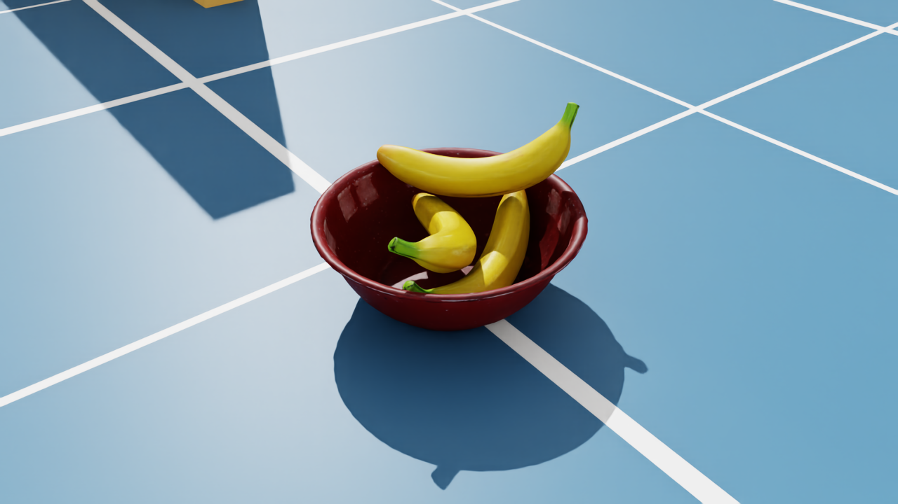
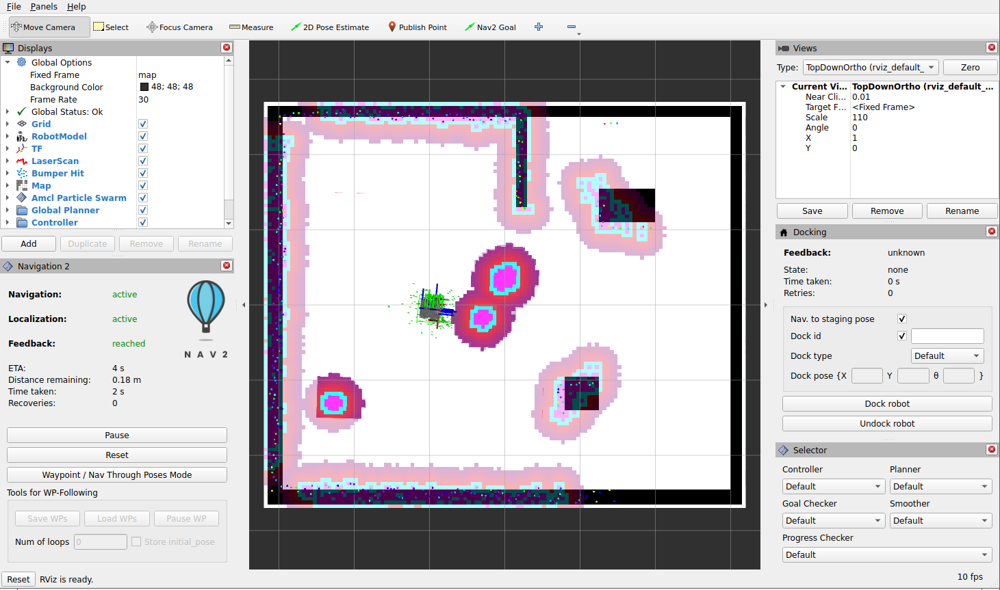
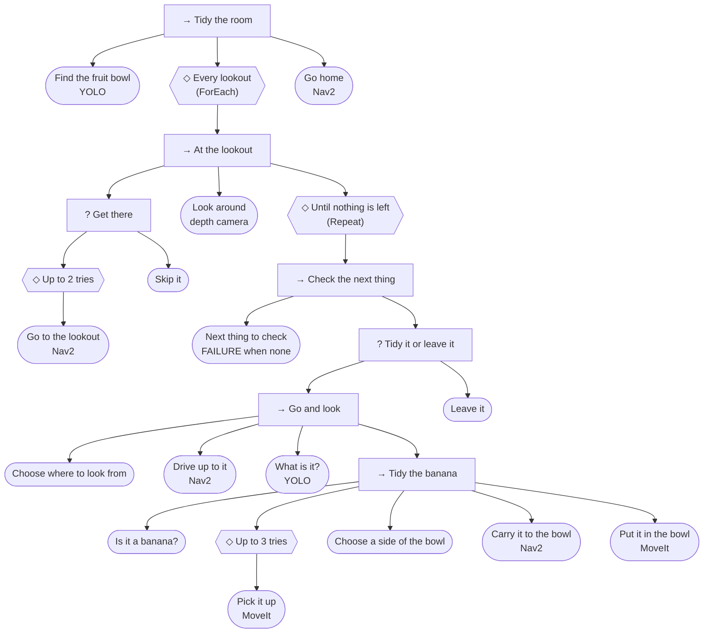

# 16 · All together: tidy the room

<p class="tutorial-meta">⏱ 60 min · Level: advanced · Script: <code>isaac/16_tidy_room.py</code> · ROS: <code>tidy.launch.py</code>, <code>tidy</code></p>

**Goal.** A real job for the Lime, with everything from tutorials 06–15 at once. Three bananas lie around the
lime_room, and the robot doesn't know where. It must **find every one, pick it up, put it into the fruit bowl,
and go home**. Nav2 drives it from lookout to lookout, the depth camera spots things on the floor, YOLO says what
they are, MoveIt picks and places, and a **behavior tree** (tutorial 15) decides what to do next.

<figure class="result" markdown>
<video controls autoplay loop muted playsinline>
  <source src="../../assets/video/tutorial16_tidy.mp4" type="video/mp4">
</video>
<figcaption>The whole job, about 7½ minutes of simulated time, sped up about 8×. The camera follows the robot: it picks up the first banana and puts it into the bowl, checks the mug in the corner (leave it), finds the banana behind the pillar, checks the bottle (leave it), finds the banana behind the divider, and comes home.</figcaption>
</figure>

{ .full }

*The fruit bowl at the end: all three bananas.*

## The job

Tutorial 13 picked up one banana that the robot could see from its start. Here:

| | Tutorial 13 | Tutorial 16 |
|---|---|---|
| Bananas | one, in front of the robot | three: one in front, one behind the pillar, one behind the divider |
| Where they are | YOLO sees it from the start | unknown: the robot has to search |
| The mug and the bottle | next to the banana, in the way | out of the way, towards the corners: things to find, check and leave alone |
| Driving | odometry; Nav2 only to park | Nav2 between all the places, centimetre moves by odometry |
| The mission | a script: step 1, step 2, ... | a behavior tree: search, check, retry, leave it |

The robot knows the map (tutorial 11) and three **lookouts**: places from which it can see most of the room.

## Concepts

### Finding things: what is not in the map

YOLO is the obvious tool for *"where is a banana?"*, but from the Lime's camera, 5.8 cm above the floor, a lying
banana is a thin yellow line. This is what YOLO (`yolo11m.pt`) says about one banana, seen from different
distances and angles:

| Distance | end-on | 30° | 60° | side-on |
|---|---|---|---|---|
| 0.5 m | banana 0.89 | banana 0.93 | banana 0.92 | banana 0.90 |
| 0.75 m | sports ball 0.68 | banana 0.85 | frisbee 0.48 | frisbee 0.83 |
| 1.0 m | sports ball 0.75 | tennis racket 0.47 | tennis racket 0.26 | frisbee 0.36 |
| 1.5 m | sports ball 0.69 | sports ball 0.25 | frisbee 0.27 | frisbee 0.33 |
| 2.0 m | sports ball 0.62 | — | frisbee 0.34 | frisbee 0.50 |

So the search uses the **depth camera** instead, and YOLO only up close:

1. **Find** (from a lookout): every depth pixel becomes a 3D point (tutorial 13's camera model and TF). Drop the
   floor, and drop everything the **map** already has: the walls, the pillar, the crate, the divider. What is
   left is *new*: things on the floor. Neighbouring points are grouped into one thing each.
2. **Check** (up close): Nav2 drives to 55 cm from each thing, and YOLO says what it is.
3. **Act**: a banana goes into the bowl; anything else stays where it is.

This is tutorial 11's rule again: *the map is for what stays put*. Anything that is not in the map is either an
obstacle or a job.

### Nav2 sees what is lower than the LiDAR

In tutorial 11, Nav2's costmaps got their obstacles from the LiDAR, which scans 16 cm above the floor. A banana
(4 cm), the mug (8 cm) and the bowl (8 cm) are invisible to it, and Nav2 would drive right over them. A real
robot adds its depth camera to the costmaps, and so does this tutorial:

- **Isaac Sim** publishes a small point cloud from the depth camera: a second render product of the same
  camera, 160 × 120 pixels, 10 times a second (`create_depth_cloud_graph`, new in `graphs.py`).
- **Nav2** (`config/nav2_params_tidy.yaml`) gets one more costmap layer, `depth_layer`, in both costmaps.

??? example "`create_depth_cloud_graph()` in `isaac/common/graphs.py`"
    ```python
    --8<-- "isaac/common/graphs.py:create_depth_cloud_graph"
    ```

```yaml
depth_layer:
  plugin: nav2_costmap_2d::VoxelLayer
  enabled: true
  publish_voxel_map: false
  origin_z: 0.0
  z_resolution: 0.05
  z_voxels: 10
  max_obstacle_height: 0.5
  mark_threshold: 0
  observation_sources: depth
  depth: {topic: /camera/camera/depth/color/points, data_type: PointCloud2, marking: true, clearing: true,
    min_obstacle_height: 0.015, max_obstacle_height: 0.5, obstacle_min_range: 0.35, obstacle_max_range: 2.5,
    raytrace_min_range: 0.35, raytrace_max_range: 2.5}
```

| Parameter | Why |
|---|---|
| a layer of its own | the LiDAR's layer *clears* every cell its beams pass through. Its beams pass over a banana, so a shared layer would erase what the camera marked |
| `VoxelLayer`, 10 voxels of 5 cm | 3D: a camera ray to the wall behind the mug passes *over* the mug and clears only the voxels it really passes through. In a flat (2D) layer, every look past the mug would erase it, and only the side last seen would remain |
| `min_obstacle_height: 0.015` | everything 1.5 cm above the floor or higher is an obstacle; the floor itself is not |
| `obstacle_min_range`, `raytrace_min_range: 0.35` | closer than 35 cm, the camera neither marks (that is the robot's own arm and gripper when it grasps) nor clears (what it saw from further away stays) |
| `obstacle_max_range`, `raytrace_max_range: 2.5` | the same: what the camera clears, it can also mark |

**What the robot knows, it tells Nav2.** The camera only ever sees the near side of a thing. In the first
version of this tutorial (see [the scene](#the-scene)), the robot found the mug from the west, so the costmaps
held the mug's west side, and Nav2, coming past from the east, drove into the rest of it. The mission, though, knows the whole mug: it is in its list of things. So it draws every
thing it knows about as a disc into a second map, `/known_things`, the same size as `/map`, and both costmaps
read it as one more layer (`things_layer`, a `StaticLayer`, combined by maximum). When a banana is picked up,
its disc goes; the mug and the bottle stay. It is tutorial 11's rule once more: `/map` holds what stays put,
`/known_things` what the robot has found on the floor.

```yaml
things_layer: {plugin: 'nav2_costmap_2d::StaticLayer', map_topic: /known_things, map_subscribe_transient_local: true, use_maximum: true}
```

{ .full }

*RViz (`tidy.launch.py`) after the first look around: the global costmap with the first banana, the bowl and the
mug in its corner (bottom left) as discs (magenta), each with its inflation, next to the walls, the divider, the
crate and the pillar from the map. The mug is far beyond the reach of Nav2's sensors here: it is in the costmap
because the mission told Nav2 about it. The robot is driving up to the banana to check it.*

**Collision checking for the Lime's shape.** MPPI's `CostCritic` normally checks for collisions with a circle
round `base_footprint` (`consider_footprint: false`). The Lime's `base_footprint` sits between its wheels, near
the front: its base reaches 7.5 cm forward but **20.5 cm back**. In the first version, turning next to the
mug, its back swept into it. And once something touches the robot, it is closer than the LiDAR's 12 cm minimum range and the camera's
35 cm: nothing marks it any more, and Nav2 pushed the bottle 1.8 m across the room. With
`consider_footprint: true`, MPPI checks the whole footprint.

!!! warning "Keep the inflation radius larger than the footprint"
    The footprint check only works if `inflation_radius` (0.30 m) is larger than the footprint's circumscribed
    radius: 0.28 m for the Lime with the stock 1 cm `footprint_padding`. A first version padded the footprint
    by 5 cm (0.33 m). Nav2 then logged *"The inflation radius (0.300000) is smaller than the circumscribed radius
    (0.333542)"* 20 times a second and quietly fell back to the circle. Raising the inflation to 0.45 m instead
    made the carry out of the first version's cluttered corner crawl or fail: MPPI barely moved (1.1 m in 45 s
    at best). So the padding is back to stock, and the margin round the mug and the bottle comes from where it
    belongs: their discs in `/known_things`.

!!! info "`nav2_params_tidy.yaml`"
    It is tutorial 11's `nav2_params.yaml` with exactly three changes: the `depth_layer` and the `things_layer`
    in both costmaps, and `consider_footprint` for MPPI. `tidy.launch.py` is tutorial 13's
    `lime_full.launch.py` with this parameter file.

## The scene

`16_tidy_room.py` is tutorial 13's robot in tutorial 13's room (real objects, the 1.5× bowl, grippy fingers),
with three changes: the mug and the bottle move out of the way, towards the corners; two more bananas; and the
depth cloud.

The first version kept the mug and the bottle where tutorial 13 has them, 30 cm from the first banana. They
boxed the banana in: only one side was left to grasp it from, and Nav2 had to squeeze between them on every
trip to the bowl. Most of the problems in [Things that went wrong](#things-that-went-wrong-while-building-this-and-the-fixes)
came from there. In a real home you would not leave a cup right next to a banana you want a robot to pick up
either. Now they are distractions: the robot finds them on its search, checks them with YOLO, and leaves them.

??? example "`setup_tidy_room()` in `isaac/common/scene.py`"
    ```python
    --8<-- "isaac/common/scene.py:setup_tidy_room"
    ```

## The tree



Each pattern from tutorial 15 has its job here:

- **ForEach** walks the lookouts; at each, **Look around** adds what it finds to the list of things.
- **Repeat until nothing is left**: *Next thing to check* chooses the nearest unchecked thing, and fails when
  there is none. That failure ends the loop (*FailureIsSuccess*), and the tree moves on to the next lookout.
- **Tidy it or leave it** is a Selector: if anything in *Go and look* fails (it is not a banana, the grasp
  failed three times, Nav2 can't get there), **Leave it** marks the thing as checked, so the robot never gets stuck
  on one thing.
- **Retry**: a missed grasp is tried again (up to three times in all), from a fresh look. A missed grasp
  usually nudges the banana, so the next try sees it differently.
- **Skip it**: a lookout that Nav2 can't reach is skipped.

```python
--8<-- "ros2_ws/src/lime_isaac_bringup/scripts/tidy.py:tree"
```

The leaves are `Action`s (tutorial 15) that call tutorial 13's `Lime`: `locate()`, `drive_to()`,
`turn_to()`, `move_arm()`, `gripper()`, `top_down_ik()`, `long_object()`, `round_object()`. The only new skill
is the floor scan.

### What the robot knows

`World` keeps the map (from `/map`, as Nav2 has it), the bowl, and the **things**: each with its position (odom
frame, like tutorial 13), what YOLO said it is, and its state (*new*, *tidied*, *left*). `free()` answers *"can
the robot stand here?"*: the Lime's footprint must be clear of the map and of every known thing. The tree uses it
to choose where to look from, from which side to grasp, and where to stand at the bowl.

??? example "`Thing` and `World` in `lime_isaac_bringup/scripts/tidy.py`"
    ```python
    --8<-- "ros2_ws/src/lime_isaac_bringup/scripts/tidy.py:things"
    ```

### Look around: the floor scan

```python
--8<-- "ros2_ws/src/lime_isaac_bringup/scripts/tidy.py:floor"
```

??? example "`LookAround`: six looks, 60° apart"
    ```python
    --8<-- "ros2_ws/src/lime_isaac_bringup/scripts/tidy.py:look_around"
    ```

### Check a thing

*Choose where to look from* tries 24 directions round the thing, nearest to the robot's side first, and takes the
first spot 55 cm away where the robot fits. Nav2 drives there (it stops within 25 cm of its goal, so the last bit
is odometry), and *What is it?* collects 3 s of YOLO detections. A detection belongs to the thing if its 3D
points (tutorial 13's `points()`) lie within 15 cm of it.

YOLO doesn't always have an answer. In its corner, with the wall close behind it, the mug is mostly not
recognised at all (from the robot's side, 1 of 12 test views gave *cup* with more than 0.5). The thing is then
*unknown*. That is fine: *Is it a banana?* fails, and *Leave it* is the safe default for anything the robot is
not sure about.

??? example "`NextThing`, `ChooseViewpoint`, `WhatIsIt`, `IsBanana`, `LeaveIt`"
    ```python
    --8<-- "ros2_ws/src/lime_isaac_bringup/scripts/tidy.py:check"
    ```

### Pick it up

Tutorial 13's grasp, with the viewpoints **chosen** instead of fixed. Tutorial 13 always looked again from 55°
further round, which suited that one banana from that one start.

1. **First look**, from where Nav2 brought the robot (55 cm away).
2. **Second look, from 45–135° further round** (90° is best). One look sees only the banana's near side. Seen
   nearly end-on, a curved banana's direction comes out about 25° wrong, and every decision after that would
   build on the error. `long_object()` gets the points of all looks together.
3. **Choose the grasp side**: as far off the banana's long axis as possible, and at least 24°. Any closer to
   end-on and the banana's near end would be under the robot's front. The robot must be able to drive straight
   in, from 60 cm to the grasp position, without touching anything. Nav2 needs 10 cm of room at the 60 cm
   point, because it takes over there after the grasp. If that side is a new place, the robot looks once
   more from there.
4. **Grasp** exactly as in tutorial 13, then **back out the way you came**, to 60 cm. Started right next to the
   mug, Nav2 swept the robot's back into it.

(With the mug and the bottle 30 cm from the first banana, as in tutorial 13, the only good side left was the
one tutorial 13 used, about 225°.)

??? example "`PickUp`"
    ```python
    --8<-- "ros2_ws/src/lime_isaac_bringup/scripts/tidy.py:pick"
    ```

### Put it in the bowl

The bowl is found once, at the start (YOLO sees it from there, as in tutorial 13). For each banana,
*Choose a side of the bowl* takes the nearest free side with 30 cm of room to any other thing, Nav2 carries
the banana there, and *Put it in the bowl* is tutorial 13's release: line up with the bowl, banana across the robot,
open the gripper above the bowl's centre (or as close as the arm reaches), fold the arm, and back out.

The bowl holds all three bananas: they pile up, and the third one rests on the other two.

??? example "`FindBowl`, `ChooseBowlSide`, `PutInBowl`"
    ```python
    --8<-- "ros2_ws/src/lime_isaac_bringup/scripts/tidy.py:bowl"
    ```

## Run it

Terminal 1, Isaac Sim:

```bash
source scripts/isaac_env.sh
python isaac/16_tidy_room.py
```

Terminal 2, the ROS 2 stack: tutorial 13's `lime_full.launch.py` with `nav2_params_tidy.yaml` (wait for
*"Managed nodes are active"* and *"You can start planning now!"*):

```bash
./scripts/build_ws.sh lime_isaac_bringup
./docker/run_ros.sh ros2 launch lime_isaac_bringup tidy.launch.py
```

Terminal 3, the mission:

```bash
./docker/run_ros.sh ros2 run lime_isaac_bringup tidy
```

The mission prints what it finds and every behaviour of the tree that succeeds (`ok`) or fails (`FAIL`), with how
long it took (wall-clock seconds; on the test PC the simulation ran at about half real time). The start, with
the first banana:

```text
YOLO: bowl (0.67) at (0.99, 0.40)
[bt] ok   Find the fruit bowl (3 s)
[bt] ok   Go to the lookout
things to check: thing at (0.75, -0.12) (331 points), thing at (-1.18, -1.37) (111 points)
[bt] ok   Look around (34 s)
[bt] ok   Next thing to check: thing at (0.75, -0.12)
[bt] ok   Choose where to look from: (0.22, 0.02)
[bt] ok   Drive up to it (4 s)
YOLO: banana at (0.75, -0.12) (0.87)
[bt] ok   What is it? (14 s)
[bt] ok   Is it a banana?
banana pointing 16 deg from 2 looks (the first alone: 47 deg)
YOLO: banana at (0.798, -0.121), pointing 17 deg from 3 looks; grasp from 270 deg
holding the banana (gripper at -0.5 mm)
[bt] ok   Pick it up (112 s)
[bt] ok   Choose a side of the bowl: 292 deg
[bt] ok   Carry it to the bowl (16 s)
tidied: the banana at (0.74, -0.11)
[bt] ok   Put it in the bowl (59 s)
[bt] ok   Drive up to it (23 s)
YOLO: unknown at (-1.18, -1.37)
[bt] ok   What is it? (13 s)
[bt] FAIL Is it a banana?
leave the unknown at (-1.18, -1.37)
[bt] ok   Leave it
[bt] FAIL Next thing to check
```

The banana first, because it is nearest; then the mug, which YOLO doesn't recognise from here (*unknown*):
not a banana, so it stays. *Next thing to check* fails, nothing is left here, and the tree moves on to the
next lookout:

```text
[bt] ok   Go to the lookout (32 s)
things to check: thing at (3.39, 0.88) (304 points), thing at (2.69, -1.66) (171 points)
...
YOLO: banana at (2.731, -1.693), pointing 113 deg from 3 looks; grasp from 0 deg
...
tidied: the banana at (2.71, -1.66)
[bt] ok   Put it in the bowl (54 s)
[bt] ok   Drive up to it (21 s)
YOLO: bottle at (3.39, 0.88) (0.85)
[bt] ok   What is it? (7 s)
[bt] FAIL Is it a banana?
leave the bottle at (3.39, 0.88)
[bt] FAIL Next thing to check
[bt] ok   Go to the lookout (22 s)
things to check: thing at (1.60, 2.04) (136 points)
...
tidied: the banana at (1.60, 2.05)
[bt] FAIL Next thing to check
[bt] ok   Go home (28 s)
room tidy: 3 bananas in the bowl, 898 s
```

The first banana really is at (0.80, −0.12), pointing 20°. Seen from the first spot alone, nearly end-on, its
direction came out as 47°; with the second look from about 90° further round, 16°.

## Automatic check

`python isaac/16_tidy_room.py --headless --test` follows the mission with the simulation's ground truth: when
each banana is lifted and when it comes to rest in the bowl, whether the robot comes home, and whether it
touched the mug or the bottle. A banana counts as in the bowl if its centre is within 10 cm of the bowl's centre
(the rim is at 12 cm) and it rests there. `tools/run_all_checks.sh 16` starts `tidy.launch.py` and the mission:

```text
[16] ground truth: banana at (0.80, -0.12), pointing 20 deg
[16] ground truth: banana2 at (2.70, -1.70), pointing 120 deg
[16] ground truth: banana3 at (1.60, 2.05), pointing 10 deg
[16] banana lifted at t = 86 s
[16] banana in the bowl, 3.7 cm from its centre at t = 121 s
[16] banana2 lifted at t = 243 s
[16] banana2 in the bowl, 1.6 cm from its centre at t = 279 s
[16] banana3 lifted at t = 399 s
[16] banana3 in the bowl, 6.9 cm from its centre at t = 435 s
[16] robot back home, arm folded at t = 453 s
[16][check] ok   banana in the bowl at the end (3.6 cm from its centre)
[16][check] ok   banana2 in the bowl at the end (1.5 cm from its centre)
[16][check] ok   banana3 in the bowl at the end (6.9 cm from its centre)
[16][check] ok   robot back home with the arm folded (within 0.3 m)
[16][check] ok   mug not bumped into (moved 0.0 cm)
[16][check] ok   bottle not bumped into (moved 0.0 cm)
[16][test] PASS
```

The whole job takes about 7½ minutes of simulated time.

??? example "Isaac Sim side: `isaac/16_tidy_room.py`"
    ```python
    --8<-- "isaac/16_tidy_room.py"
    ```

??? example "The launch file: `lime_isaac_bringup/launch/tidy.launch.py`"
    ```python
    --8<-- "ros2_ws/src/lime_isaac_bringup/launch/tidy.launch.py"
    ```

??? example "The whole mission: `lime_isaac_bringup/scripts/tidy.py`"
    ```python
    --8<-- "ros2_ws/src/lime_isaac_bringup/scripts/tidy.py"
    ```

## Things that went wrong while building this (and the fixes)

Most of these happened in the first version, with the mug and the bottle 30 cm from the first banana. The
fixes stayed: they make the robot careful wherever things stand close together.

| Symptom | Cause | Fix |
|---|---|---|
| YOLO called a banana 1 m away a *frisbee* or a *sports ball* | from 5.8 cm above the floor, a lying banana is a thin yellow line | the depth camera finds things, YOLO checks them from 55 cm |
| Nav2 crept towards each goal and then gave up: *"Failed to make progress"* | a goal tolerance of 10 cm: MPPI's slow last centimetres tripped the progress checker (0.5 m in 10 s) | Jazzy's 25 cm; the mission does the last centimetres itself, by odometry |
| Right after a grasp, the robot nudged the mug | Nav2 took over right next to the mug | back out the way you came, then Nav2 |
| Nav2 pushed the bottle 1.8 m across the room | MPPI checked only a circle round `base_footprint`; once touching, the bottle was too close for the LiDAR (12 cm) and the camera (35 cm) | `consider_footprint: true`, and the things' discs in `/known_things` as the margin |
| The robot backed into the bowl and got stuck | the camera *cleared* the cells within 35 cm (its rays to the walls pass over the bowl, in 2D) but did not *mark* them, so the bowl vanished from the costmap | `raytrace_min_range: 0.35` as well: near the camera, neither mark nor clear |
| Nav2 still brushed the mug, coming from the side the camera had never seen | the camera marks only the sides of a thing it has seen | the mission draws the things it knows into `/known_things`, a costmap layer |
| Nav2 could not leave the spot the mission had chosen | the mission's spot was free for the bare footprint, but too tight for Nav2 | 10 cm of room round every spot where Nav2 starts or stops |
| Carrying the banana out of the cluttered corner, Nav2 barely moved and gave up | a 5 cm footprint padding needed a 0.45 m inflation radius, which put cost on most of that corner; MPPI crept (1.1 m in 45 s at best) or stopped | stock padding and inflation, margins from `/known_things`; in the end, the mug and the bottle out of the way (the carry then took 14–27 s) |
| A "thing" at the corner of the pillar | a few depth points at the pillar's edge | look only 2 m far, and a thing needs 40 points |
| The banana slipped out of the gripper, or the fingers closed on nothing | the second look came from nearly the same direction as the first. Seen end-on, the banana's direction came out 25° wrong (41° instead of 20°), so the grasp was crooked | a second look from 45–135° further round, with the points of all looks together (18°); up to 3 tries |
| The mission's memory grew to 1.1 GB | tutorial 13's `Lime` kept every detection, with its depth image | keep the last 60 |

## Where to go from here

- **More kinds of things.** `WhatIsIt` already tells bottles from bananas. Give each class its own place:
  bottles to the recycling, toys into a box. The tree gets one more Selector: *which job is this?*
- **Watch the tree live.** Tick the tree with `py_trees_ros.trees.BehaviourTree` instead of py_trees' own
  (`py_trees_ros` is in the container): it publishes the tree, and the `py-trees-tree-watcher` command shows it,
  with every status, while the mission runs.
- **Find instead of patrol.** The lookouts are fixed. A real robot would choose the next lookout from what it
  has not seen yet (*frontier exploration*).
- **SLAM.** Make the map with tutorial 14 first, and give it to Nav2 instead of tutorial 11's map (the `map`
  argument of the Nav2 include in `lime_full.launch.py`).
